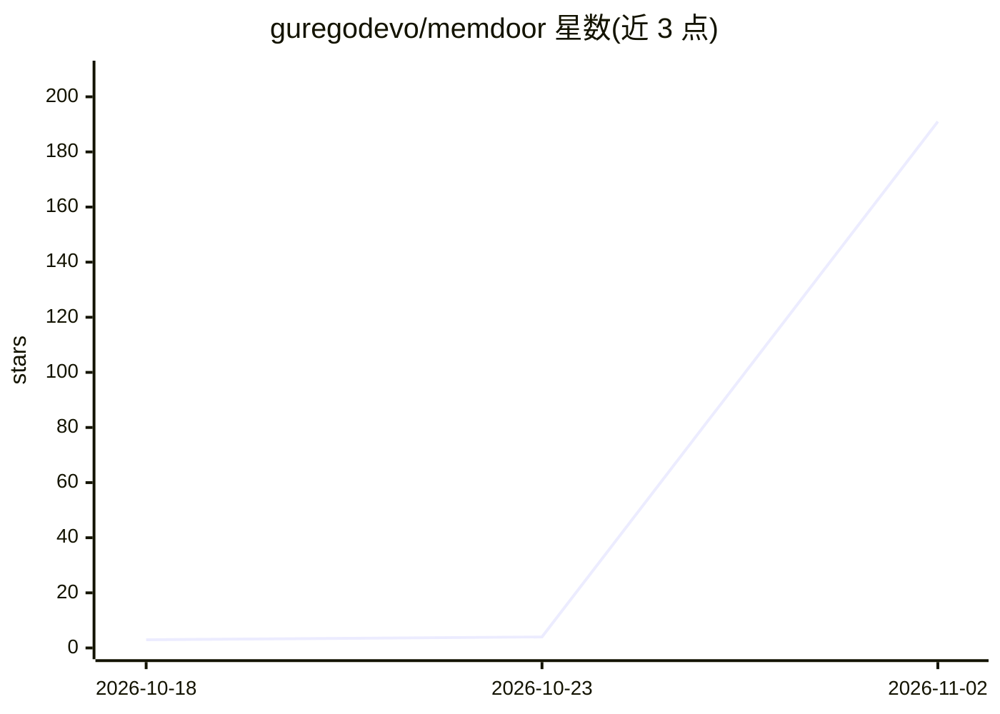

# guregodevo/memdoor

⭐ 191 · Go · Apache-2.0 · 推送 2026-11-01 · [GitHub](https://github.com/guregodevo/memdoor) · [官网](https://memdoor.ai) · 个人维护

**单二进制 CLI 编码/自动化 agent，本地或 SSH 运行，BYOK**

Go 编写的单文件 CLI 编码与自动化代理：交互式 TUI、IDE（ACP，Zed/JetBrains/VS Code）或手机端访问，也可从脚本、CI、cron 发起运行并在任一入口续接。通过 /connect 接入 OpenRouter、Anthropic、OpenAI、Gemini、DeepSeek 等，或本地运行时（Ollama、llama.cpp、vLLM、janis）免 key 运行。内置决策模型在对话模型前过滤无关上下文以减少 token 用量；多步任务以 YAML 工作流文件保存在仓库中，支持并行步骤、审批门与失败续跑；含 9 个内置 GitHub Actions 工作流（PR 审查、测试编写等）。macOS/Linux/Windows 单二进制安装，Apache 2.0。

## 筛选速览

| 维度 | 判定 | 备注 |
|---|---|---|
| AI 角色 | `ai-ecosystem` | LLM/agent 周边工具 |
| 许可风险 | `permissive` | Apache-2.0 |
| 部署形态 | `None` |  |
| 模型依赖 | local-ok | 支持本地模型 |
| 硬件要求 | — | 无带数字的原话,不猜 |
| 安装摩擦 | `medium` | 含编译或系统依赖之一 |
| 成熟度 | — | 结构信号不足 |

## 能力要点

- 单静态二进制，本地或经 SSH 网关远程运行，无需 Docker/Python
- 决策模型前置过滤上下文（README 实测输入 token −74%）
- YAML 工作流：并行步骤、检查通过才算完成、审批门、失败续跑
- 9 个内置 GitHub Actions 工作流（pr-triage、pr-review、write-tests 等）

## 适用场景

- 在终端或 IDE 里让 agent 修测试、改代码并自动验证
- CI 中自动审查 PR、编写测试或解释失败原因
- SSH 到远程机器长时间运行任务，手机或另一终端续接会话
- 免 API key 用本地模型跑 CI 第一轮代码审查

## 场景标签

`编码 Agent` `代码审查` `工作流自动化` · 领域:效率与自动化

## 证据(README 行号)

> L2:  Your daemon agents on every door. A lightweight coding and automation agent in a single CLI binary. Run it locally 
> L181: |`/connect`|Add a provider: OpenRouter, Anthropic, OpenAI, Gemini, DeepSeek, Baseten, Groq, xAI, any OpenAI-compat

## 星数曲线

2026-10-18 3 → 2026-11-02 191（+188）

---
*卡片 v1 · prompt 1.4 · 生成 2026-11-02 · 置信度 high · 依据 README sha `045255ce3c42` · [字段定义](../../DATASET.md)*
