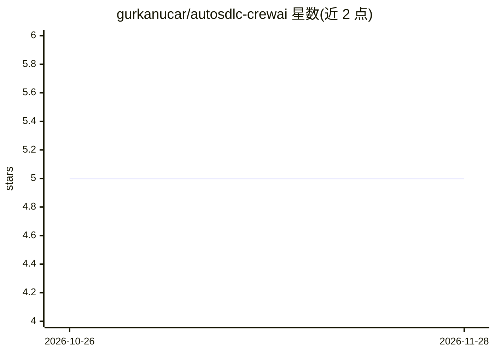

# gurkanucar/autosdlc-crewai

⭐ 5 · HTML · 推送 2026-11-05 · [GitHub](https://github.com/gurkanucar/autosdlc-crewai) · 个人维护

**CrewAI 多智能体流水线：从想法生成完整软件项目**

用 CrewAI Flows 编排八个 agent（需求分析、架构设计、评审、编码、测试、部署、维护等）走完软件开发生命周期，每个阶段输出可编辑、可下载的 Markdown 文档（含 Mermaid 图、追溯矩阵），带评审与修复循环及 Streamlit 实时工作区。生成器自身为 Python，产出项目可选其他语言与技术栈，可交付 Docker 镜像、可执行文件或源码。需 OpenCode Go API key，生成代码以本地子进程执行，README 提醒运行前需人工审查。

## 筛选速览

| 维度 | 判定 | 备注 |
|---|---|---|
| AI 角色 | `ai-native` | 本体是模型或模型工具 |
| 许可风险 | `none` | — |
| 部署形态 | `desktop` | 安装包/桌面程序 |
| 模型依赖 | — | README 未给出锁定关系 |
| 硬件要求 | — | 无带数字的原话,不猜 |
| 安装摩擦 | `low` | 无编译、无系统依赖或容器化 |
| 成熟度 | — | 结构信号不足 |

## 能力要点

- 八个 agent 覆盖规划、设计、评审、编码、测试、部署全流程
- 评审与修复循环：测试失败触发修复，可从 Testing 阶段重试
- 文档支持节级编辑，agent 提案以 diff 形式接受或拒绝
- 交付形式可选 Docker 镜像、可执行文件、启动脚本或源码

## 适用场景

- 从一段想法描述自动生成带测试与文档的项目骨架
- 在实时工作区里与 agent 对话推进架构决策
- 生成包含 Docker Compose 服务（数据库/缓存/可观测性）的项目

## 场景标签

`多智能体` `编码 Agent` · 领域:Agent 开发

## 证据(README 行号)

> L5: **Turn a software idea into a tested, documented project with a team of AI agents.** AutoSDLC coordinates eight agen
> L43: - Plans, analyzes requirements, designs and reviews architecture, writes code, runs tests, prepares deployment, and
> L59: Add your OpenCode Go key to `.env` (the file is ignored by Git):

## 星数曲线

2026-10-26 5 → 2026-11-28 5（+0）

---
*卡片 v1 · prompt 1.4 · 生成 2026-11-21 · 置信度 high · 依据 README sha `111fa78f53a8` · [字段定义](../../DATASET.md)*
