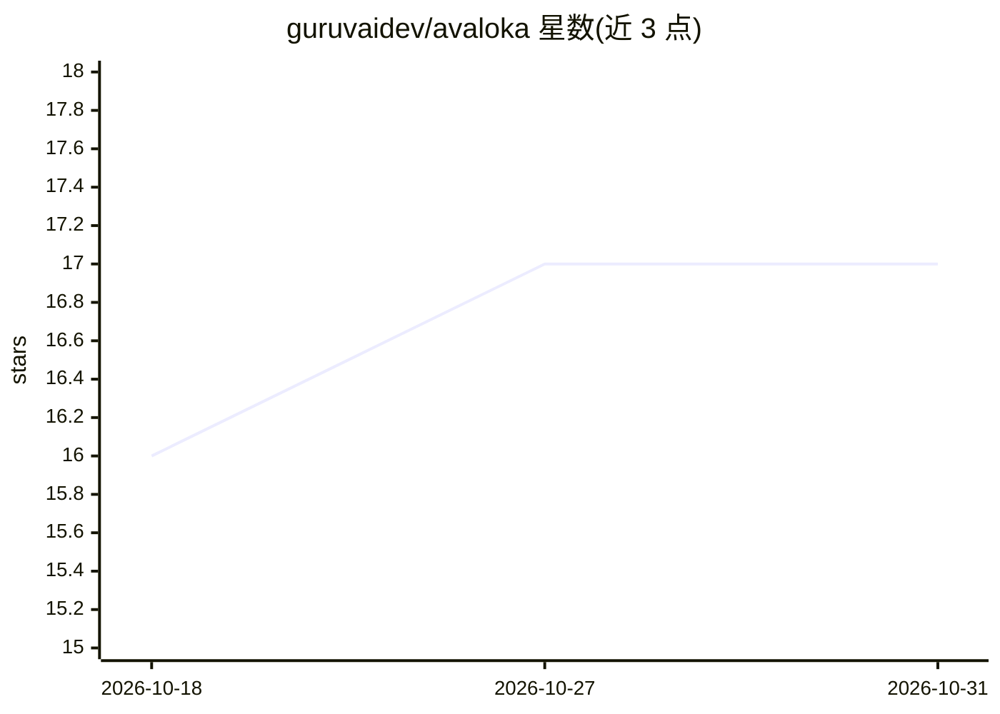

# guruvaidev/avaloka

⭐ 17 · Python · Apache-2.0 · 推送 2026-10-29 · [GitHub](https://github.com/guruvaidev/avaloka) · [官网](https://www.avaloka.ai) · 组织维护

**多 Agent 数据科学平台：从原始数据到训练并部署模型，含自检证据层**

以 Planner 为队长、十余个专职 Agent（采样、画像、编码、验证、执行、数据搬运、训练、可视化、评判）协作的开源系统：用自然语言提问后，Agent 采样数据、生成并通过三层校验的 Python 代码，在本地或 Ray 集群运行，用 PyTorch/ONNX/MLflow 训练并登记模型，全程记录产物。证据层含泄漏检测、基线对比与无 LLM 的声明核验器。可完全离线运行，也提供托管商业版；README 公开标注知识图谱与学习循环覆盖尚薄、基准 39/50。

## 筛选速览

| 维度 | 判定 | 备注 |
|---|---|---|
| AI 角色 | `ai-native` | 本体是模型或模型工具 |
| 许可风险 | `permissive` | Apache-2.0 |
| 部署形态 | `None` |  |
| 模型依赖 | local-ok | 支持本地模型 |
| 硬件要求 | — | 无带数字的原话,不猜 |
| 安装摩擦 | `low` | 无编译、无系统依赖或容器化 |
| 成熟度 | `idea` | |

## 能力要点

- 十余个专职 Agent 通过共享状态对象协作，Planner 负责对话与调度
- 证据层：拒绝泄漏数据训练、强制击败平凡基线、确定性核验文字与数字
- 执行可在本地、Kubernetes Job 或 Ray 集群，Daft 支持 CSV/Parquet/Delta/Iceberg 等格式
- 可完全离线部署（本地模型服务、内嵌 embedding、--network none 校验）

## 适用场景

- 用自然语言对数据集做端到端分析与建模
- 跨数据库/数仓/对象存储的数据处理与 ETL
- 需要可审计证据（防泄漏、基线、声明核验）的数据科学流程

## 场景标签

`多智能体` `数据分析` `模型训练` · 领域:Agent 开发

## 证据(README 行号)

> L19: state the question in plain language and a team of agents — planner, profiler,
> L20: coder, validator, executor, trainer, visualizer — samples the data, plans the
> L21: analysis, writes and validates the Python, runs it locally or on a Ray cluster,
> L58: Twelve roles, one shared state object. The **Planner** is the team lead — it

## 星数曲线

2026-10-18 16 → 2026-10-31 17（+1）

---
*卡片 v1 · prompt 1.4 · 生成 2026-10-29 · 置信度 high · 依据 README sha `19fb7e4f8f0d` · [字段定义](../../DATASET.md)*
