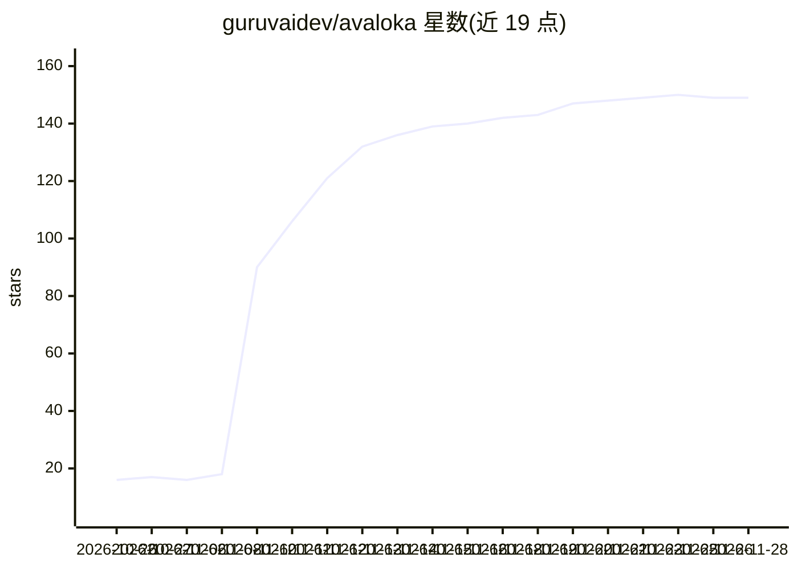

# guruvaidev/avaloka

⭐ 149 · Python · Apache-2.0 · 推送 2026-11-23 · [GitHub](https://github.com/guruvaidev/avaloka) · [官网](https://www.avaloka.ai) · 组织维护

**面向数据科学工作的多智能体平台：从原始数据到已部署模型**

Avaloka 由规划、画像、编码、验证、执行、训练、可视化等角色组成的智能体团队，对数据集进行分析、ETL、模型训练与部署。关键机制包括三层代码验证、模型须通过基线对比、以及不依赖 LLM 的确定性 Claim Verifier。快速启动仅需 Python 3.11/3.12，本地无模型无 key 即可运行；完整平台通过 Helm 部署在 Kubernetes 或 Ray 集群，分析结果带血缘记录与可复现代码。

## 筛选速览

| 维度 | 判定 | 备注 |
|---|---|---|
| AI 角色 | `ai-native` | 本体是模型或模型工具 |
| 许可风险 | `permissive` | Apache-2.0 |
| 部署形态 | `library` | 以包/库形式分发 |
| 模型依赖 | local-ok | 支持本地模型 |
| 硬件要求 | — | 无带数字的原话,不猜 |
| 安装摩擦 | `low` | 无编译、无系统依赖或容器化 |
| 成熟度 | — | 结构信号不足 |

## 能力要点

- 多个专职智能体分工：规划、采样画像、写码、验证、执行、训练、可视化
- 证据层三重检查：防数据泄漏、基线置信区间评估、确定性 Claim Verifier
- 支持多模型多 provider 混用与自动 fallback（OpenRouter/Bedrock/本地 vLLM/Ollama）
- 分析产物含血缘图谱、可复现脚本与 HTML 报告

## 适用场景

- 上传数据集后让智能体完成画像、分析与报告
- 训练分类模型并自动校验其击败基线后才交付
- 在自有 Kubernetes/Ray 环境中调度大规模数据分析任务
- 完全离线在笔记本上运行统计分析

## 场景标签

`多智能体` `数据分析` `模型训练` · 领域:Agent 开发

## 证据(README 行号)

> L10: **A team of specialist AI agents that takes a dataset from raw rows to a served
> L22: trainer, visualizer — samples the data, plans the analysis, writes and validates
> L82: avaloka analyze app/sample_data/healthcare_dataset.csv \

## 星数曲线

2026-10-26 16 → 2026-11-28 149（+133）

---
*卡片 v1 · prompt 1.4 · 生成 2026-11-27 · 置信度 high · 依据 README sha `22a315cd71f2` · [字段定义](../../DATASET.md)*
