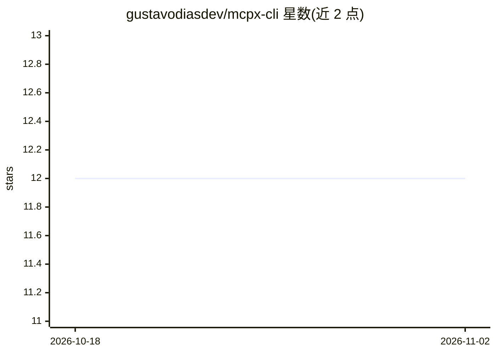

# gustavodiasdev/mcpx-cli

⭐ 12 · TypeScript · MIT · 推送 2026-02-06 · [GitHub](https://github.com/gustavodiasdev/mcpx-cli) · 个人维护

**统一配置 MCP 服务器并同步到各 AI CLI 的命令行工具**

Node.js/TypeScript 编写的交互式 CLI：以单个 .mcpx.json 文件作为项目内 MCP 服务器配置的来源，自动生成 Claude Code、Gemini CLI、OpenAI Codex、OpenCode、GitHub Copilot CLI、VS Code、IntelliJ IDEA、Kimi CLI 等各自格式的配置文件。提供向导式初始化、服务器增删、导入已有配置与 sync 重新生成等命令；处理各工具的差异（TOML 智能合并、字段名映射、Copilot shell alias 注入）。通过 npm 全局安装，要求 Node >= 20。

## 筛选速览

| 维度 | 判定 | 备注 |
|---|---|---|
| AI 角色 | `ai-ecosystem` | LLM/agent 周边工具 |
| 许可风险 | `permissive` | MIT |
| 部署形态 | `library` | 以包/库形式分发 |
| 模型依赖 | — | README 未给出锁定关系 |
| 硬件要求 | — | 无带数字的原话,不猜 |
| 安装摩擦 | `low` | 无编译、无系统依赖或容器化 |
| 成熟度 | — | 结构信号不足 |

## 能力要点

- 单 .mcpx.json 生成 8 种 AI CLI 的 MCP 配置文件
- 交互式向导：检测/导入已有配置、添加服务器、选择 providers
- 处理各 provider 格式差异（TOML 合并、字段映射、Copilot 自动 shell alias）
- mcpx import 可从现有配置导入服务器

## 适用场景

- 同时使用多个 AI CLI 时只维护一份 MCP 服务器配置
- 在新项目中快速初始化并同步 MCP 配置到各工具
- 把已在一个工具里配置的 MCP 服务器导入并分发到其他工具

## 场景标签

 · 领域:开发工具/MCP 配置管理

## 证据(README 行号)

> L3: > **One config to rule them all.** Configure your MCP servers once, deploy to every AI CLI automatically.
> L28: **MCPX** maintains a single canonical config file (`.mcpx.json`) per project and **automatically generates** the co

## 星数曲线

2026-10-18 12 → 2026-11-02 12（+0）

---
*卡片 v1 · prompt 1.4 · 生成 2026-11-01 · 置信度 high · 依据 README sha `e0df131515ee` · [字段定义](../../DATASET.md)*
