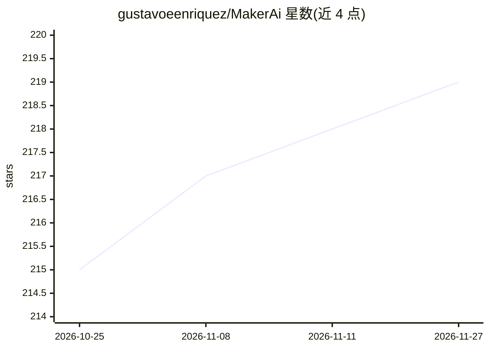

# gustavoeenriquez/MakerAi

⭐ 219 · Pascal · MIT · 推送 2026-11-24 · [GitHub](https://github.com/gustavoeenriquez/MakerAi) · [官网](https://www.youtube.com/@cimamaker3945) · 个人维护

**给 Delphi/Free Pascal 开发者构建 AI 应用的原生框架**

面向 Delphi 10.4+（完整支持 Delphi 12）与 Free Pascal 3.2+ 的原生 AI 框架：提供 RAG 管道（向量与图检索，含 VQL/GQL 查询语言）、带图编排与人工审批的自主 Agent、MCP 服务器/客户端、A2A 协议、SKILL.md 技能加载、OpenTelemetry 追踪与工具调用护栏，以及可在运行时切换提供商的通用连接器。附 FMX 聊天 UI 组件与多个演示工程。FPC 移植位于 fpc 分支。

## 筛选速览

| 维度 | 判定 | 备注 |
|---|---|---|
| AI 角色 | `ai-ecosystem` | LLM/agent 周边工具 |
| 许可风险 | `permissive` | MIT |
| 部署形态 | `desktop` | 安装包/桌面程序 |
| 模型依赖 | local-ok | 支持本地模型 |
| 硬件要求 | — | 无带数字的原话,不猜 |
| 安装摩擦 | `low` | 无编译、无系统依赖或容器化 |
| 成熟度 | — | 结构信号不足 |

## 能力要点

- RAG 管道支持向量与知识图谱检索，带类 SQL 查询语言 VQL/GQL
- Agent 图编排支持 checkpoint 与 human-in-the-loop 审批
- MCP 服务器/客户端与 A2A 协议，支持 PPM 注册表分发 agent 包
- 通用连接器可在不改代码的情况下运行时切换 LLM 提供商

## 适用场景

- 在 Delphi 桌面应用中接入多家 LLM 提供商
- 用 Object Pascal 构建检索增强（RAG）生产系统
- 开发多 Agent 系统并通过 MCP/A2A 暴露或调用工具

## 场景标签

`RAG` `知识图谱` `多智能体` · 领域:Agent 开发

## 证据(README 行号)

> L21: But on top of that, MakerAI is a **complete AI application ecosystem** that lets you build production-grade intelli
> L23: - **RAG pipelines** (vector and graph-based) with SQL-like query languages (VQL / GQL)
> L24: - **Autonomous Agents** with graph orchestration, checkpoints, and human-in-the-loop approval
> L31: - **Universal Connector** — switch providers at runtime without changing your application code

## 星数曲线

2026-10-25 215 → 2026-11-27 219（+4）

---
*卡片 v1 · prompt 1.4 · 生成 2026-11-25 · 置信度 high · 依据 README sha `1285d47af0f6` · [字段定义](../../DATASET.md)*
