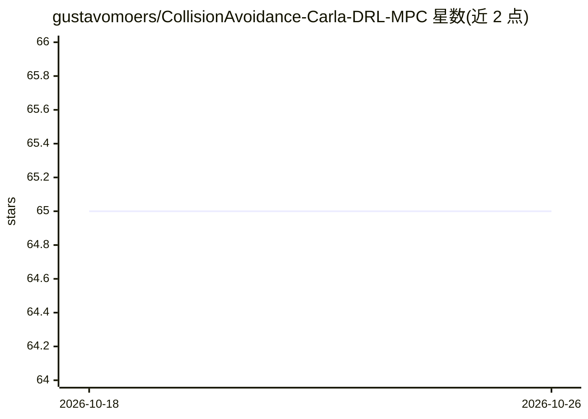

# gustavomoers/CollisionAvoidance-Carla-DRL-MPC

⭐ 65 · Python · MIT · 推送 2026-08-20 · [GitHub](https://github.com/gustavomoers/CollisionAvoidance-Carla-DRL-MPC) · 个人维护

**自动驾驶避障系统：DRL 路径规划 + MPC 控制在 CARLA 中运行**

混合避障研究项目：使用 Stable Baselines3 的 Recurrent PPO 训练强化学习智能体作为路径规划模块，输出五个连续动作值生成三次样条曲线，由 MPC 控制器据此控制车辆，在 CARLA 仿真器中应对自车接近静止障碍车的场景。状态空间含横向/纵向距离、速度、加速度与偏航角。附作者论文 PDF，修改并集成了 yangggzhang 的 Carla-MPC 实现。运行方式为调整 train.py 参数后直接运行，需自装 CARLA 仿真器。

## 筛选速览

| 维度 | 判定 | 备注 |
|---|---|---|
| AI 角色 | `ai-native` | 本体是模型或模型工具 |
| 许可风险 | `permissive` | MIT |
| 部署形态 | `None` |  |
| 模型依赖 | — | README 未给出锁定关系 |
| 硬件要求 | — | 无带数字的原话,不猜 |
| 安装摩擦 | `low` | 无编译、无系统依赖或容器化 |
| 成熟度 | — | 结构信号不足 |

## 能力要点

- Recurrent PPO 作为路径规划模块，MPC 负责车辆控制
- 动作空间五个连续值生成三次样条路径供 MPC 跟踪
- 在 CARLA 仿真器中处理接近静止车辆的避障场景
- 附作者论文 Thesis_Collision_Avoidance_System.pdf

## 适用场景

- 研究 DRL 与 MPC 混合控制在避障任务中的实现
- 复现或修改 CARLA 仿真中的避障训练流程
- 作为自主车辆路径规划课程的参考实现

## 场景标签

`强化学习` · 领域:训练与推理

## 证据(README 行号)

> L4: This project develops a hybrid collision avoidance system for autonomous vehicles, combining Deep Reinforcement Lear
> L7: The project employs Recurrent Proximal Policy Optimization (Recurrent PPO) from Stable Baselines3 for training the r

## 星数曲线

2026-10-18 65 → 2026-10-26 65（+0）

---
*卡片 v1 · prompt 1.4 · 生成 2026-10-24 · 置信度 high · 依据 README sha `39f47bf5aa4e` · [字段定义](../../DATASET.md)*
