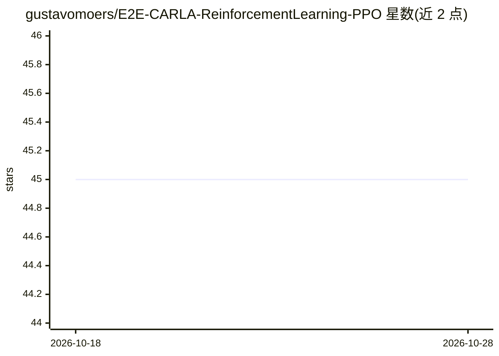

# gustavomoers/E2E-CARLA-ReinforcementLearning-PPO

⭐ 45 · Python · MIT · 推送 2026-08-20 · [GitHub](https://github.com/gustavomoers/E2E-CARLA-ReinforcementLearning-PPO) · 个人维护

**CARLA 模拟器中端到端强化学习避撞驾驶模型（循环 PPO）**

在 CARLA 0.9.12 模拟环境中训练端到端自动驾驶避撞模型：输入 RGB 相机图像，直接输出加速与转向控制值。算法采用基于 Stable Baselines3 实现的循环 PPO，使模型保留历史决策记忆以处理序列性事件。已以 90 km/h 完成约 80,000 步训练并展示避撞结果，训练脚本 train.py 支持参数调整。附作者论文 Thesis_Collision_Avoidance_System.pdf，后续计划动态场景训练与 RL+MPC 混合方案。

## 筛选速览

| 维度 | 判定 | 备注 |
|---|---|---|
| AI 角色 | `ai-native` | 本体是模型或模型工具 |
| 许可风险 | `permissive` | MIT |
| 部署形态 | `None` |  |
| 模型依赖 | — | README 未给出锁定关系 |
| 硬件要求 | — | 无带数字的原话,不猜 |
| 安装摩擦 | `low` | 无编译、无系统依赖或容器化 |
| 成熟度 | — | 结构信号不足 |

## 能力要点

- RGB 图像端到端映射到加速与转向控制值
- 基于 Stable Baselines3 的循环 PPO 实现
- 90 km/h 下完成 80,000 步训练并展示避撞演示
- train.py 提供可调参数，附论文 PDF

## 适用场景

- 在 CARLA 中复现和扩展自动驾驶避撞训练
- 作为端到端强化学习驾驶的研究与论文参考
- 在此模型基础上继续训练以覆盖更多速度与场景

## 场景标签

`强化学习` `科研工具` · 领域:学习与行业

## 证据(README 行号)

> L5: This project is an end-to-end application of reinforcement learning for collision avoidance in autonomous vehicles u
> L9: The reinforcement learning model used in this project is the recurrent version of the Proximal Policy Optimization (

## 星数曲线

2026-10-18 45 → 2026-10-28 45（+0）

---
*卡片 v1 · prompt 1.4 · 生成 2026-10-25 · 置信度 high · 依据 README sha `0e60372653f3` · [字段定义](../../DATASET.md)*
