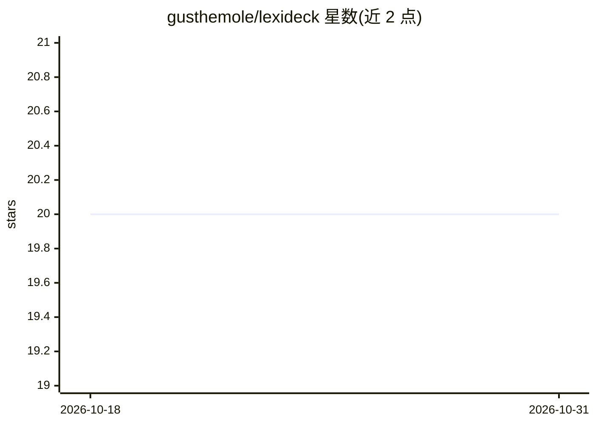

# gusthemole/lexideck

⭐ 20 · GPL-3.0 · 推送 2025-11-20 · [GitHub](https://github.com/gusthemole/lexideck) · [官网](https://www.lexidecktechnologies.com/) · 个人维护

**将 LLM 变成多智能体协作系统的元提示词框架**

一个系统级元提示词文件（lexideck2025.md）：粘贴到系统提示后，使单一 LLM 表现为多个协作智能体。定义六个角色智能体（Lexi/Dexter/Maisie/Gus/Anna/Titus）、统一超平面状态、MASS 多智能体语义模拟器、名为 The Sieve 的伦理评估层、涌现命令机制与 Handlebars 风格条件输出模板。支持单智能体与多智能体/编排两种使用模式，可生成 HTML/JS/Python 单文件可视化产物，无需额外代码或外部编排逻辑。

## 筛选速览

| 维度 | 判定 | 备注 |
|---|---|---|
| AI 角色 | `ai-ecosystem` | LLM/agent 周边工具 |
| 许可风险 | `viral` | GPL-3.0 |
| 部署形态 | `None` |  |
| 模型依赖 | — | README 未给出锁定关系 |
| 硬件要求 | — | 无带数字的原话,不猜 |
| 安装摩擦 | `low` | 无编译、无系统依赖或容器化 |
| 成熟度 | — | 结构信号不足 |

## 能力要点

- 六个带角色与心理画像（EmojiChain）的核心智能体定义
- MASS 多智能体语义模拟器可输出叙事与可运行的单文件代码产物
- The Sieve 三视角（功利/义务/务实）伦理评估层
- 每轮生成 3-5 个涌现命令，可映射为真实工具或伪命令

## 适用场景

- 把整个文件粘贴为系统提示，让单模型按不同人格回答
- 作为 Supervisor + 子智能体编排栈的角色与行为规范
- 生成多智能体辩论叙事或带代码的模拟可视化产物

## 场景标签

`多智能体` `提示工程` · 领域:Agent 开发

## 证据(README 行号)

> L5: Lexideck 2025 is a system-level meta-prompt that turns a raw LLM into a small civilization of cooperating agents — o
> L198: 1. **Supervisor agent** uses the full Lexideck 2025 system prompt.

## 星数曲线

2026-10-18 20 → 2026-10-31 20（+0）

---
*卡片 v1 · prompt 1.4 · 生成 2026-10-28 · 置信度 high · 依据 README sha `8d56d17c0e1f` · [字段定义](../../DATASET.md)*
