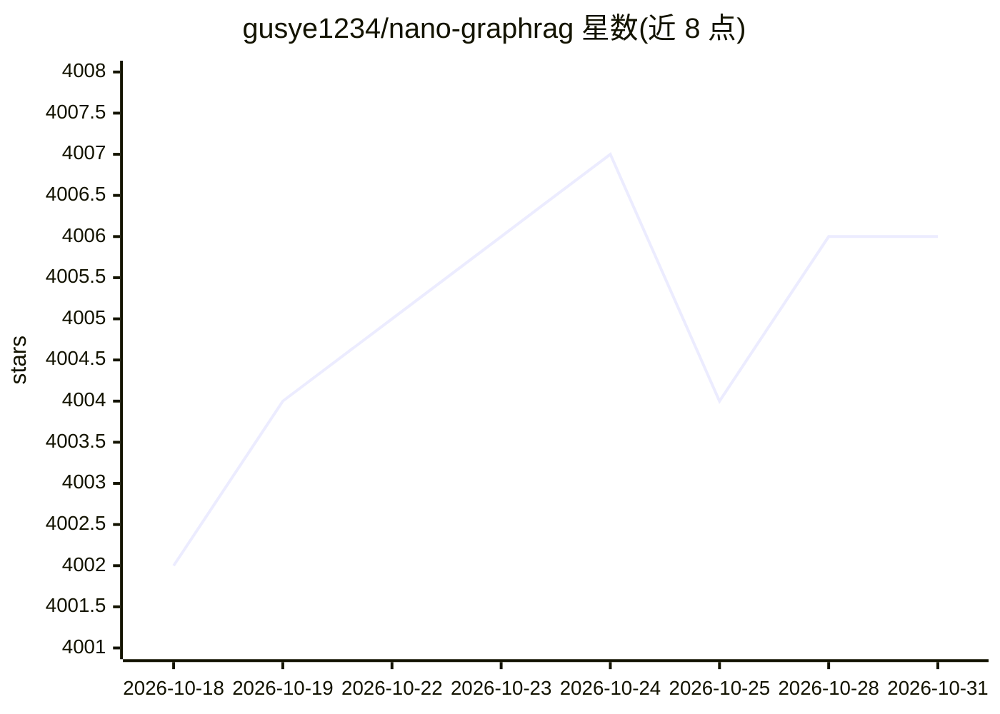

# gusye1234/nano-graphrag

⭐ 4,006 · Python · MIT · 推送 2026-01-27 · [GitHub](https://github.com/gusye1234/nano-graphrag) · 个人维护

**约 1100 行代码的轻量 GraphRAG 实现，供阅读与改造**

以「smaller, faster, cleaner」为目标重写的 GraphRAG Python 库，核心代码约 1100 行，支持局部/全局检索问答、增量插入（md5 去重）、naive RAG、全异步接口与全类型注解。LLM 层内置 OpenAI、Amazon Bedrock、Azure OpenAI 接入，示例覆盖 ollama、DeepSeek、sentence-transformers；向量存储内置 nano-vectordb/hnswlib，图存储内置 networkx/neo4j，各组件均可替换。限制：未实现官方 covariates 特性，全局检索采用 top-K 社区策略而非 map-reduce。

## 筛选速览

| 维度 | 判定 | 备注 |
|---|---|---|
| AI 角色 | `ai-ecosystem` | LLM/agent 周边工具 |
| 许可风险 | `permissive` | MIT |
| 部署形态 | `library` | 以包/库形式分发 |
| 模型依赖 | local-ok | 支持本地模型 |
| 硬件要求 | — | 无带数字的原话,不猜 |
| 安装摩擦 | `low` | 无编译、无系统依赖或容器化 |
| 成熟度 | — | 结构信号不足 |

## 能力要点

- 核心代码约 1100 行，面向阅读与二次开发
- 增量插入：内容 md5 去重，避免重复计算
- LLM/嵌入/向量库/图存储各组件均可替换实现
- 全异步 API（每个方法均有对应 aNAME 版本）

## 适用场景

- 学习 GraphRAG 内部机制的精简代码库
- 用本地 ollama 或 DeepSeek 跑通 GraphRAG 流程
- 作为可改造的 GraphRAG 基座集成进自己的项目

## 场景标签

`RAG` `知识图谱` · 领域:知识与检索

## 证据(README 行号)

> L6:  A simple, easy-to-hack GraphRAG implementation
> L28: 😊 This project provides a **smaller, faster, cleaner GraphRAG**, while remaining the core functionality(see benchma
> L138: |LLM|OpenAI|Built-in|

## 星数曲线

2026-10-18 4,002 → 2026-10-31 4,006（+4）

---
*卡片 v1 · prompt 1.4 · 生成 2026-10-20 · 置信度 high · 依据 README sha `2f16ff22bab8` · [字段定义](../../DATASET.md)*
