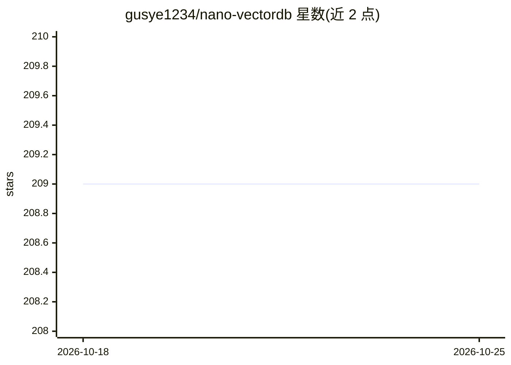

# gusye1234/nano-vectordb

⭐ 209 · Python · MIT · 推送 2026-01-09 · [GitHub](https://github.com/gusye1234/nano-vectordb) · 个人维护

**单依赖 numpy 的轻量向量数据库，供原型与 RAG 使用**

以 numpy 为唯一依赖的向量数据库 Python 库：支持 upsert、基于 embedding 的 top-k 查询、条件过滤、JSON 文件持久化与自动索引加载，另提供 MultiTenantNanoVDB 通过内存队列管理多租户向量库。官方基准显示在 MacBook M3 Pro 上对 10 万条 1024 维向量插入约 2 秒、查询约 0.1 秒，保存会生成约 520M 的 JSON 文件。适合快速原型与小型场景。

## 筛选速览

| 维度 | 判定 | 备注 |
|---|---|---|
| AI 角色 | `ai-ecosystem` | LLM/agent 周边工具 |
| 许可风险 | `permissive` | MIT |
| 部署形态 | `library` | 以包/库形式分发 |
| 模型依赖 | — | README 未给出锁定关系 |
| 硬件要求 | — | 无带数字的原话,不猜 |
| 安装摩擦 | `low` | 无编译、无系统依赖或容器化 |
| 成熟度 | — | 结构信号不足 |

## 能力要点

- 单依赖 numpy，无外部服务
- 10 万向量查询约 0.1 秒（官方基准）
- MultiTenantNanoVDB 支持朴素多租户
- JSON 文件存储并自动加载索引

## 适用场景

- 为原型项目快速搭一个嵌入式向量检索
- RAG 流程中存储与查询 embedding
- 多租户场景下管理多个小型向量库

## 场景标签

`向量数据库` · 领域:知识与检索

## 证据(README 行号)

> L12: 🌬️ A vector database implementation with single-dependency (`numpy`).
> L50: - `__vector__`: must pass, your embedding `np.ndarray`.

## 星数曲线

2026-10-18 209 → 2026-10-25 209（+0）

---
*卡片 v1 · prompt 1.4 · 生成 2026-10-22 · 置信度 high · 依据 README sha `cd38b3afb4a7` · [字段定义](../../DATASET.md)*
