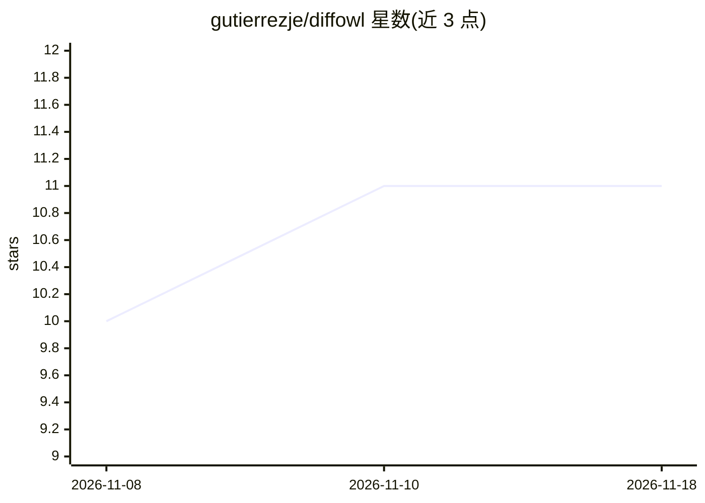

# gutierrezje/diffowl

⭐ 11 · TypeScript · MIT · 推送 2026-11-09 · [GitHub](https://github.com/gutierrezje/diffowl) · [官网](https://gutierrezje.github.io/diffowl/) · 个人维护

**开发者终端里的本地 AI 代码评审 CLI：审查变更并跟踪发现**

DiffOwl 是一个命令行工具，针对 agent 或人编写的 Git 变更执行代码评审。每次评审以全新上下文运行于用户已配置的后端（OpenCode、Codex CLI、Claude Code CLI 或 Cursor SDK），发现项以稳定 ID 存入仓库内 `.diffowl/state.db`，支持 dismiss/fix/regressed 状态流转与后续评审的对比标注；`diffowl readiness` 以退出码报告分支是否全部提交已评审且发现项已处理。评审循环与状态均在本地 checkout 中，不提供 PR 评论，不修改代码。需要 Node.js 22.14.0+。

## 筛选速览

| 维度 | 判定 | 备注 |
|---|---|---|
| AI 角色 | `ai-native` | 本体是模型或模型工具 |
| 许可风险 | `permissive` | MIT |
| 部署形态 | `library` | 以包/库形式分发 |
| 模型依赖 | — | README 未给出锁定关系 |
| 硬件要求 | — | 无带数字的原话,不猜 |
| 安装摩擦 | `low` | 无编译、无系统依赖或容器化 |
| 成熟度 | — | 结构信号不足 |

## 能力要点

- 通过 OpenCode/Codex/Claude Code/Cursor SDK 等已有后端运行评审
- 发现项带稳定 ID 与状态记忆：dismissed 保持、regressed 自动重开
- readiness 命令以退出码输出分支交接就绪判定，可被脚本与 agent 查询
- TypeScript 变更获得符号、相关测试与 import 引用的额外结构化上下文

## 适用场景

- 推送前对 agent 生成的代码变更做独立二次评审
- 在 CI 或脚本中检查分支是否所有发现项已处理
- 跨多次评审跟踪同一代码位置的发现项状态

## 场景标签

`代码审查` · 领域:编码与开发

## 证据(README 行号)

> L10: DiffOwl is an independent reviewer for agent-written code. It reviews a Git change with the model you choose, store
> L20: DiffOwl starts every review from a clean prompt and context that it builds itself from the diff. The review runs th

## 星数曲线

2026-11-08 10 → 2026-11-18 11（+1）

---
*卡片 v1 · prompt 1.4 · 生成 2026-11-18 · 置信度 high · 依据 README sha `7f0499523eb0` · [字段定义](../../DATASET.md)*
