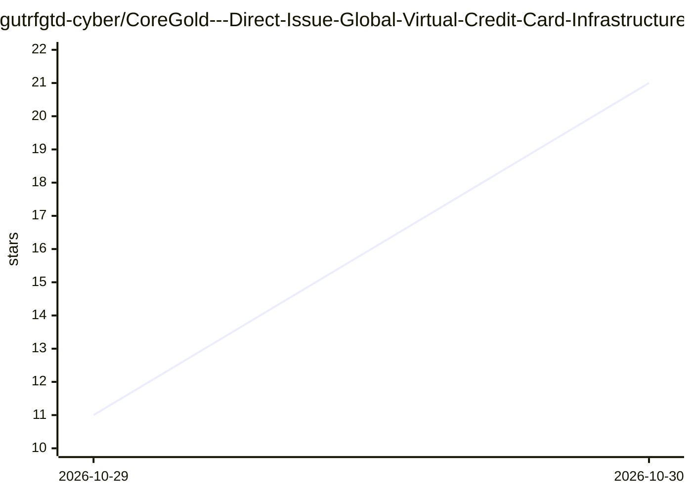

# gutrfgtd-cyber/CoreGold---Direct-Issue-Global-Virtual-Credit-Card-Infrastructure-Management-Console

⭐ 21 · 推送 2026-10-28 · [GitHub](https://github.com/gutrfgtd-cyber/CoreGold---Direct-Issue-Global-Virtual-Credit-Card-Infrastructure-Management-Console) · [官网](https://app.coregold.io/signup?invite_code=ADvlj9b) · 组织维护 · 中文 README

**商业虚拟信用卡（VCC）管理后台：跨境出海团队开卡与额度管控**

直连国际清算网络的 Visa / Mastercard 虚拟信用卡发卡与管理服务，面向出海电商卖家、广告投放团队与开发者。机制包括：USDT 链上充值实时兑换为美元余额、按业务场景批量生成独立 16 位卡号卡片、单卡设置单次/每日/每月支出上限与商户锁定、闲置卡暂停销卡并回拨余额。提供 Web 管理控制台，通过注册链接使用，未见开源代码或本地部署途径；页面含营销性表述，事实细节以控制台实际功能为准。

## 筛选速览

| 维度 | 判定 | 备注 |
|---|---|---|
| AI 角色 | `ai-enhanced` | 去掉 AI 部分产品仍成立 |
| 许可风险 | `none` | — |
| 部署形态 | `None` |  |
| 模型依赖 | — | README 未给出锁定关系 |
| 硬件要求 | — | 无带数字的原话,不猜 |
| 安装摩擦 | `low` | 无编译、无系统依赖或容器化 |
| 成熟度 | — | 结构信号不足 |

## 能力要点

- USDT 链上充值自动清算并兑换为平台美元余额
- 批量生成独立卡号卡片，支持卡片标签与消费上限设定
- 单卡商户锁定与每日/月度额度硬性拒付
- 实时扣费流水、失败拦截原因查询与余额回拨

## 适用场景

- 为多个广告账户或电商店铺分配互相隔离的支付卡
- 订阅 OpenAI、Claude 等海外 AI 工具与云服务时规避发卡地风控拒付
- 按部门或项目控制海外订阅与采购的支出额度

## 场景标签

 · 领域:跨境支付/金融服务

## 证据(README 行号)

> L2: 直连国际清算网络的合规级 Visa / Mastercard 虚拟信用卡（VCC）管理后台。专注解决跨境出海投放封号、多店铺资金连环风控、AI 工具拒付及海外账单超支，支持 USDT 即充即开与全场景精细化额度隔离。
> L33: |**顶级 AI 与开发框架**|`OpenAI / ChatGPT`, `Claude Pro`, `Cursor`, `Midjourney`|支持订阅海外开发者套餐，规避发卡地风控拦截，即绑即扣|

## 星数曲线

2026-10-29 11 → 2026-10-30 21（+10）

---
*卡片 v1 · prompt 1.4 · 生成 2026-10-30 · 置信度 low · 依据 README sha `f1d48b16af72` · [字段定义](../../DATASET.md)*
