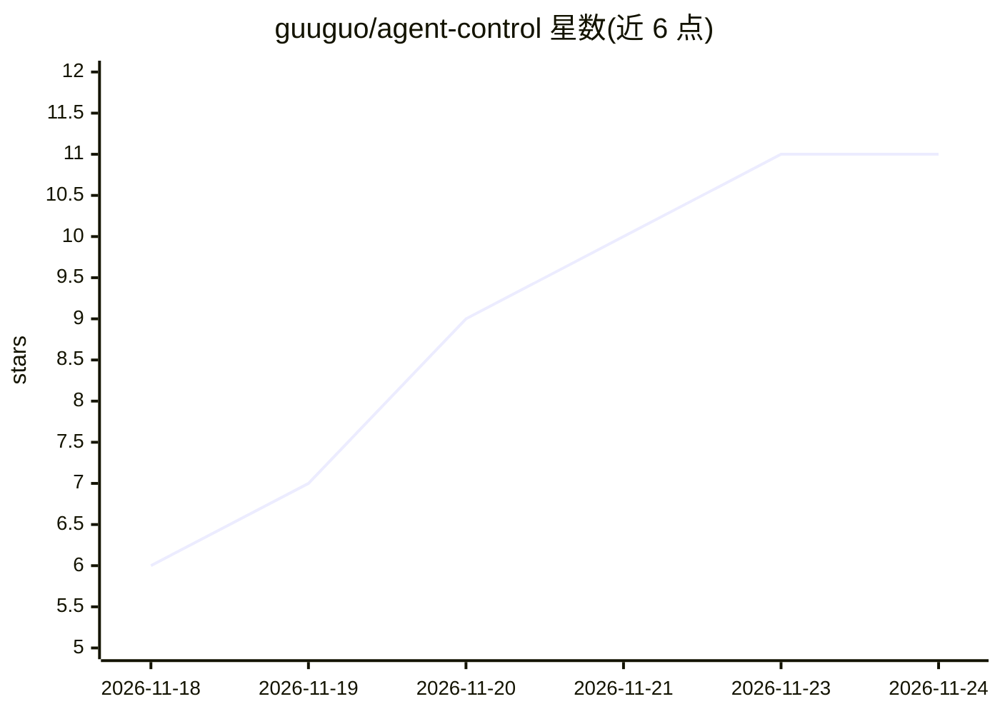

# guuguo/agent-control

⭐ — · [GitHub]() · 个人维护 · 中文 README

**电脑与手机远程统一管理多个编程智能体的自托管控制台**

自托管控制台，统一查看与操控 Codex、Claude Code、Antigravity、Grok 等编程智能体：按项目查看运行中与历史任务、续发消息、切换模型、批量归档，支持多账号归属标注。提供手机扫码远程（Cloudflare/Tailscale/固定域名等多种隧道方案）、免提语音总控（mlx-whisper 离线识别，可选切换语音理解后端模型）、执行统计（耗时、Token、工具次数）与只读数据索引，不修改原工具配置与记录。一条脚本安装，支持桌面壳与容器部署。

## 筛选速览

| 维度 | 判定 | 备注 |
|---|---|---|
| AI 角色 | `ai-ecosystem` | LLM/agent 周边工具 |
| 许可风险 | `viral` | — |
| 部署形态 | `library` | 以包/库形式分发 |
| 模型依赖 | — | README 未给出锁定关系 |
| 硬件要求 | — | 无带数字的原话,不猜 |
| 安装摩擦 | `low` | 无编译、无系统依赖或容器化 |
| 成熟度 | — | 结构信号不足 |

## 能力要点

- 统一管理 4 家编程智能体任务，多账号归属自动标注
- 手机扫码远程看输出、发指令、批权限，多种隧道方案可切换
- 免提语音总控，支持 VAD 断句与口头批准/拒绝
- 执行统计：按 Agent/模型汇总耗时中位/P90 与协议 Token

## 适用场景

- 在手机上远程查看和续跑电脑上的编程智能体任务
- 开车或免提场景下语音批复智能体的权限请求
- 集中监控多项目多账号智能体的执行耗时与 Token 用量

## 场景标签

`多智能体` `编码 Agent` · 领域:Agent 开发

## 证据(README 行号)

> L5: > 在电脑和手机上统一看 **Codex**、**Claude Code**、**Antigravity** 和 **Grok** 的任务进度、随时续跑对话与批复权限 —— 一条命令装好即用，不改动原工具的任何配置与记录。
> L52: 2. **电脑端统一管理**：左侧按项目查看所有正在跑或历史中的智能体任务，点进去即可续发消息、切换模型、设置自动推进或批量归档；同一智能体存在多个账号（如多 Codex 账号）时，列表与顶部栏自动标出具体账号归属。

## 星数曲线

2026-11-18 6 → 2026-11-24 11（+5）

---
*卡片 v1 · prompt 1.4 · 生成 2026-11-20 · 置信度 high · 依据 README sha `bc48b08e3881` · [字段定义](../../DATASET.md)*
