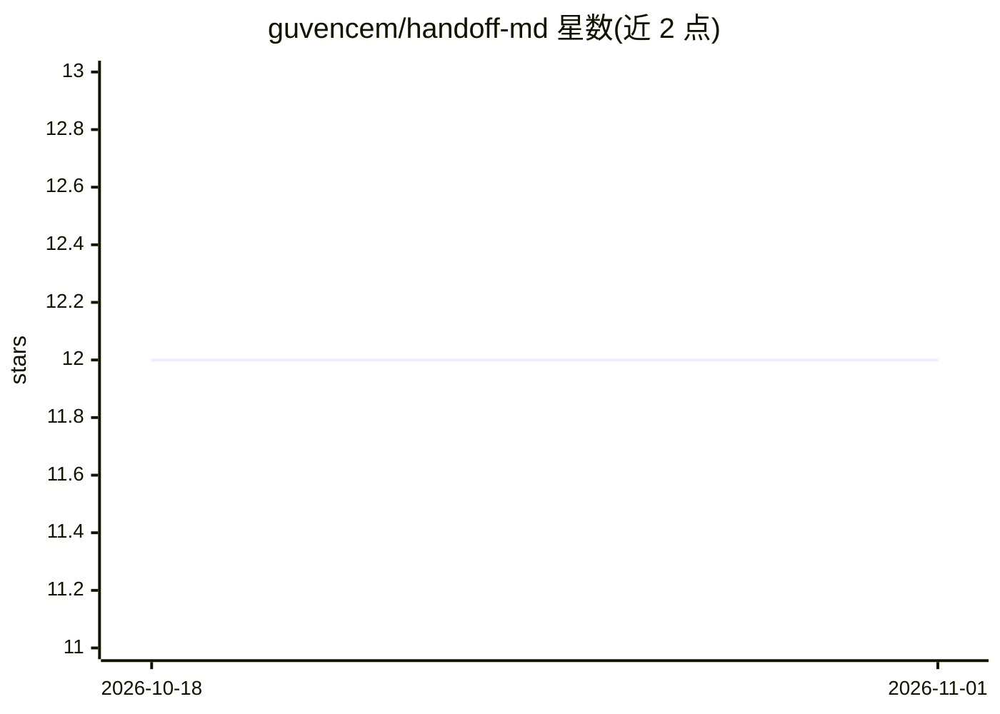

# guvencem/handoff-md

⭐ 12 · TypeScript · MIT · 推送 2026-02-27 · [GitHub](https://github.com/guvencem/handoff-md) · 个人维护

**一条命令从任意仓库生成可移植的 AI 上下文文件**

基于 Node.js + git 的 CLI 工具：运行 npx handoff-md 即扫描仓库状态（git 活动、未提交变更、TODO 等），生成一份 HANDOFF.md 上下文文件，粘贴给 Claude、GPT、Gemini、Copilot、Codex 或本地模型即可让其了解项目现状。提供 compact/standard/full 三种输出规模（约 1.5K-5K tokens），支持剪贴板复制、stdout 输出与安装为 git post-commit 钩子自动更新。无配置、无 API key、无依赖，仅需 Node.js 和 git。定位为 CLAUDE.md 的补充，可读取已有 CLAUDE.md 并将其规则纳入输出。

## 筛选速览

| 维度 | 判定 | 备注 |
|---|---|---|
| AI 角色 | `ai-ecosystem` | LLM/agent 周边工具 |
| 许可风险 | `permissive` | MIT |
| 部署形态 | `library` | 以包/库形式分发 |
| 模型依赖 | — | README 未给出锁定关系 |
| 硬件要求 | — | 无带数字的原话,不猜 |
| 安装摩擦 | `low` | 无编译、无系统依赖或容器化 |
| 成熟度 | — | 结构信号不足 |

## 能力要点

- 从仓库 git 状态自动生成上下文文件，无需手动维护
- 兼容多种模型（Claude/GPT/Gemini/Copilot/Codex/本地模型）
- 三种输出规模：compact 约 1.5K / standard 约 3K / full 约 5K tokens
- 可安装为 git post-commit 钩子保持上下文自动更新

## 适用场景

- 在 Claude、Cursor、Copilot 等工具间切换模型时快速交接项目上下文
- 新会话开始时让 AI 立即了解架构与当前工作状态
- 通过 git 钩子让上下文文件随提交保持最新

## 场景标签

`提示工程` · 领域:Agent 开发

## 证据(README 行号)

> L3: One command to generate a portable AI context file from any repo.
> L35: Paste this into **any** AI model — Claude, GPT, Gemini, Codex, local models — and it instantly understands your pro
> L45: |`-f, --format <level>`|`compact` (~1.5K tokens), `standard` (~3K), `full` (~5K)|

## 星数曲线

2026-10-18 12 → 2026-11-01 12（+0）

---
*卡片 v1 · prompt 1.4 · 生成 2026-11-01 · 置信度 high · 依据 README sha `ba09d670e2d9` · [字段定义](../../DATASET.md)*
