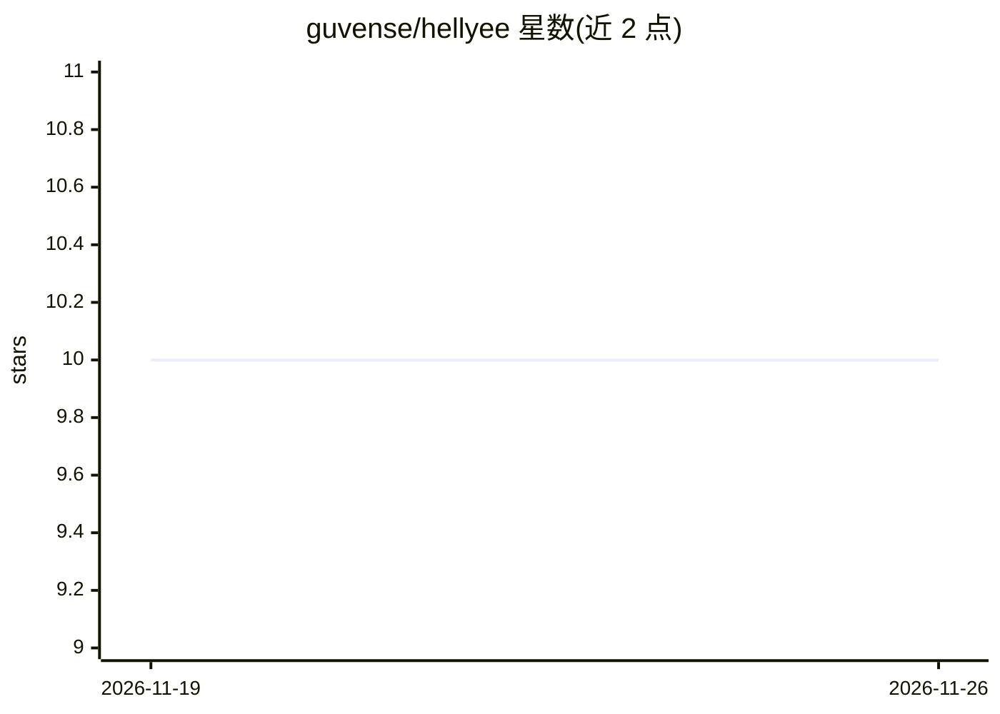

# guvense/hellyee

⭐ 10 · Python · MIT · 推送 2026-08-21 · [GitHub](https://github.com/guvense/hellyee) · 个人维护

**通过对话让 Claude 操控 Ableton Live 完成编曲与混音的 MCP 服务器**

以 MCP 服务器形式连接 Claude 与 Ableton Live：Claude 启动 hellyee 子进程，经 OSC 与 AbletonOSC 远程脚本通信，驱动 Live Object Model。提供 76 个工具覆盖轨道/剪辑创建、MIDI 编辑、设备加载、混音测量、编排、自动化与母带处理；随附 8 个技能文件教授制作知识。混音通过读取真实电平表迭代调整。需 Live 11/12 与 Python 3.10+，Live 端控制界面需手动配置。

## 筛选速览

| 维度 | 判定 | 备注 |
|---|---|---|
| AI 角色 | `ai-ecosystem` | LLM/agent 周边工具 |
| 许可风险 | `permissive` | MIT |
| 部署形态 | `library` | 以包/库形式分发 |
| 模型依赖 | locked-api |  |
| 硬件要求 | — | 无带数字的原话,不猜 |
| 安装摩擦 | `low` | 无编译、无系统依赖或容器化 |
| 成熟度 | — | 结构信号不足 |

## 能力要点

- 76 个 MCP 工具覆盖创作到母带全流程
- 按真实输出电平表测量式混音与母带
- 8 个技能文件提供制作知识（流派规范、母带响度目标等）
- 嗡鸣转 MIDI 与语音命令等本地音频输入功能

## 适用场景

- 在 Ableton Live 中用自然语言创作完整曲目
- 让 Claude 按电平表读数迭代调整混音
- 分析歌曲并分轨重制为其他风格

## 场景标签

 · 领域:音乐制作/AI 工具

## 证据(README 行号)

> L14: MCP
> L67: Claude launches `hellyee` as a subprocess and talks to it over MCP. hellyee

## 星数曲线

2026-11-19 10 → 2026-11-26 10（+0）

---
*卡片 v1 · prompt 1.4 · 生成 2026-11-19 · 置信度 high · 依据 README sha `7ea709902b09` · [字段定义](../../DATASET.md)*
