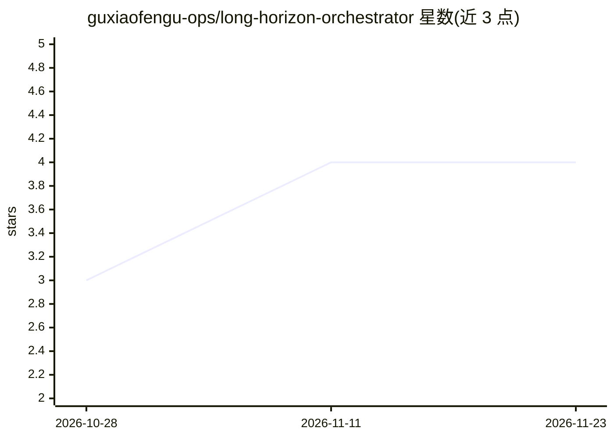

# guxiaofengu-ops/long-horizon-orchestrator

⭐ 4 · Python · MIT · 推送 2026-11-03 · [GitHub](https://github.com/guxiaofengu-ops/long-horizon-orchestrator) · [官网](https://guxiaofengu-ops.github.io/long-horizon-orchestrator/) · 个人维护 · 中文 README

**给 Codex Agent 管理长程推理/训练循环的持久化等待与唤醒工具**

一个以 Codex Skill 形式安装的持久化编排器，把 AI 的“判断”与机械“等待”分离：用 SQLite WAL 维护状态机与租约防重复，独立 Worker 在 Runner 断线后继续执行阶段命令，通过产物新鲜度、JSON 字段、文件大小和退出码验证结果，并在 AI 审查检查点处暂停推进、经官方 codex queue 或 codex exec resume 投递一次唤醒。支持 local/tmux/SLURM/systemd 四种调度后端，提供 Python CLI 与测试套件，MIT 许可。

## 筛选速览

| 维度 | 判定 | 备注 |
|---|---|---|
| AI 角色 | `ai-ecosystem` | LLM/agent 周边工具 |
| 许可风险 | `permissive` | MIT |
| 部署形态 | `None` |  |
| 模型依赖 | — | README 未给出锁定关系 |
| 硬件要求 | — | 无带数字的原话,不猜 |
| 安装摩擦 | `low` | 无编译、无系统依赖或容器化 |
| 成熟度 | — | 结构信号不足 |

## 能力要点

- 基于 SQLite WAL 的持久状态机与租约式防重复机制
- Runner 断线后仍可继续运行的独立阶段 Worker
- local、tmux、SLURM、systemd 四种调度后端
- 官方 codex queue 集成与 codex exec resume 回退路径

## 适用场景

- 让 Codex 管理数小时的推理→审查→训练循环而不消耗模型用量等待
- 在长训练任务阶段间设置 AI 显式审查检查点
- 在 SLURM/systemd 环境下调度并验证长任务产物

## 场景标签

`工作流自动化` · 领域:效率与自动化

## 证据(README 行号)

> L9: 一个用于“推理 → 审查 → 训练”长程循环的持久化 Codex Skill，内置 SQLite 状态、独立 Worker、有限启动预检和官方会话唤醒。
> L20: 长时间推理和训练不应该让一个 Agent 回合及其模型上下文持续数小时。Long Horizon Orchestrator 把“判断”和“等待”分开：
> L36: - local、tmux、SLURM 和 systemd 四种调度后端

## 星数曲线

2026-10-28 3 → 2026-11-23 4（+1）

---
*卡片 v1 · prompt 1.4 · 生成 2026-11-21 · 置信度 high · 依据 README sha `9b7e9616e686` · [字段定义](../../DATASET.md)*
