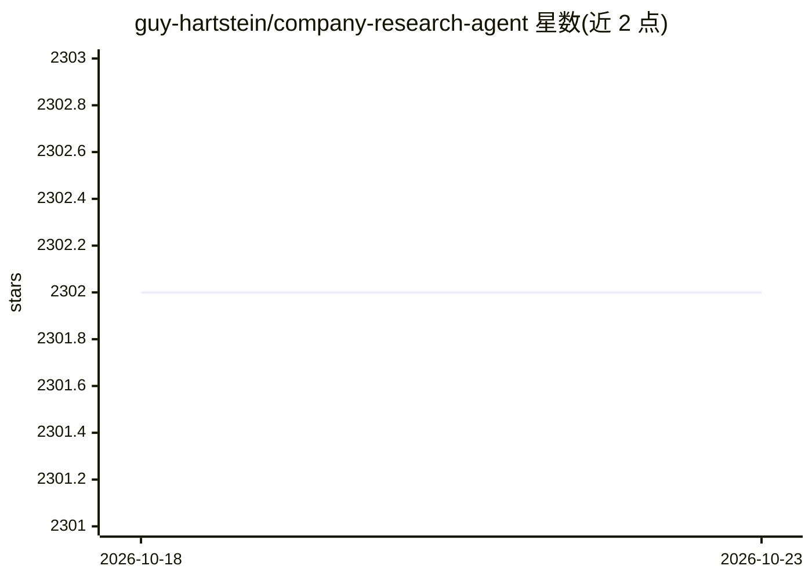

# guy-hartstein/company-research-agent

⭐ 2,302 · Python · Apache-2.0 · 推送 2026-10-22 · [GitHub](https://github.com/guy-hartstein/company-research-agent) · [官网](https://companyresearcher.tavily.com) · 个人维护

**输入公司名生成有出处尽调简报的多 agent 研究工具**

基于 LangGraph 多 agent 框架与 Tavily 搜索的公司研究工具：输入公司名后自动调研其业务、行业、财务背景与近期新闻，经检索、相关性筛选与综合阶段生成结构化简报，并支持 PDF 导出。推理通过 OpenRouter 接入任一模型（应用内 Settings 可选），也可直接用 OpenAI/Gemini key。技术栈为 FastAPI 后端 + React/Vite 前端，任务进度以 SSE 流式推送到浏览器，可选 MongoDB 持久化。需自备至少一个 LLM key 与 Tavily key。

## 筛选速览

| 维度 | 判定 | 备注 |
|---|---|---|
| AI 角色 | `ai-native` | 本体是模型或模型工具 |
| 许可风险 | `permissive` | Apache-2.0 |
| 部署形态 | `self-host` | docker 或自建部署 |
| 模型依赖 | locked-api |  |
| 硬件要求 | — | 无带数字的原话,不猜 |
| 安装摩擦 | `low` | 无编译、无系统依赖或容器化 |
| 成熟度 | — | 结构信号不足 |

## 能力要点

- Tavily 搜索与相关性评分进行来源筛选
- 通过 OpenRouter 使用任意模型，或回退到 OpenAI/Gemini key
- 研究进度 SSE 流式推送到浏览器，报告可导出 PDF
- 可选 MongoDB 持久化任务与报告

## 适用场景

- 对目标公司快速生成有来源支撑的尽调简报
- 跟踪某公司的业务、行业与近期新闻动态
- 导出 PDF 格式的研究报告用于汇报

## 场景标签

`多智能体` `金融量化` · 领域:Agent 开发

## 证据(README 行号)

> L3: An agentic research tool that turns a company name into a structured, source-backed briefing. The FastAPI backend co
> L9: - Researches a company’s business, industry, financial context, and recent news.
> L11: - Runs on any model available through OpenRouter — pick it from the in-app Settings — or on direct OpenAI/Gemini ke

## 星数曲线

2026-10-18 2,302 → 2026-10-23 2,302（+0）

---
*卡片 v1 · prompt 1.4 · 生成 2026-10-21 · 置信度 high · 依据 README sha `748d8eb8bff1` · [字段定义](../../DATASET.md)*
