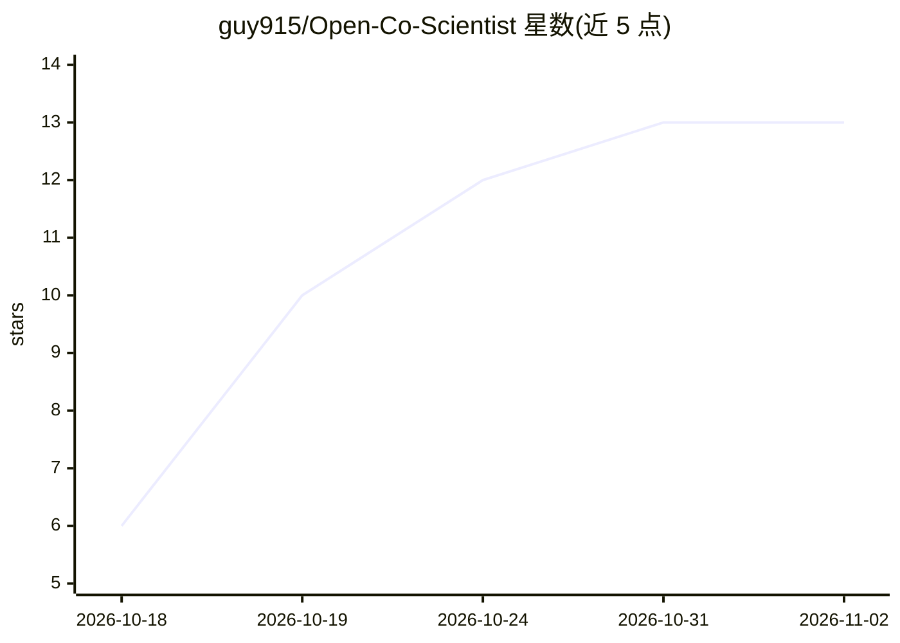

# guy915/Open-Co-Scientist

⭐ 13 · Python · Apache-2.0 · 推送 2026-10-29 · [GitHub](https://github.com/guy915/Open-Co-Scientist) · [官网](https://open-coscientist.com) · 个人维护

**多 agent 科研伙伴：把研究目标转成有出处的排序假设**

Google AI co-scientist 设计的独立开源复现：监督者协调生成、反思、排名、演化、邻近与元评审六个 agent，从研究目标出发检索文献、起草竞争性假设、批评与事实核查，经 Elo 辩论锦标赛演化出排序结果，输出含机制、实验建议与来源引用的报告；运行中可追加约束和提问。内置 MCP 服务器接入 PubMed、arXiv、UniProt 等文献与数据库工具。免费托管服务受免费 OpenRouter 路由与每日次数限制，本地运行需 Python 3.12、Node.js 22.13+ 与 Bun 1.3.14。

## 筛选速览

| 维度 | 判定 | 备注 |
|---|---|---|
| AI 角色 | `ai-native` | 本体是模型或模型工具 |
| 许可风险 | `permissive` | Apache-2.0 |
| 部署形态 | `None` |  |
| 模型依赖 | locked-api |  |
| 硬件要求 | — | 无带数字的原话,不猜 |
| 安装摩擦 | `low` | 无编译、无系统依赖或容器化 |
| 成熟度 | — | 结构信号不足 |

## 能力要点

- 六 agent + 监督者的多 agent 假设生成与 Elo 排名流程
- 内置 MCP 服务器接入 PubMed/OpenAlex/arXiv/UniProt 等文献与数据库工具
- 假设引用检索来源（[C*] 键），标记撤稿论文并对入围假设逐条核查
- deterministic 测试后端可在无 API key 下运行全流程测试

## 适用场景

- 从机制或药物重定位等研究问题出发生成排序假设与实验建议
- 在文献检索与证据核查支撑下做科研探索的起点
- 带自己的 API key 做更大规模的研究运行

## 场景标签

`多智能体` `科研工具` · 领域:Agent 开发

## 证据(README 行号)

> L14: Describe what you want to understand, such as a mechanism, a drug-repurposing
> L16: literature, drafts competing hypotheses, critiques and fact-checks them, runs
> L47: |**Cooperating agents**|Six agents under a supervisor: generation, reflection, ranking, evolution, proximity and me

## 星数曲线

2026-10-18 6 → 2026-11-02 13（+7）

---
*卡片 v1 · prompt 1.4 · 生成 2026-10-31 · 置信度 high · 依据 README sha `5ed1e58607ed` · [字段定义](../../DATASET.md)*
