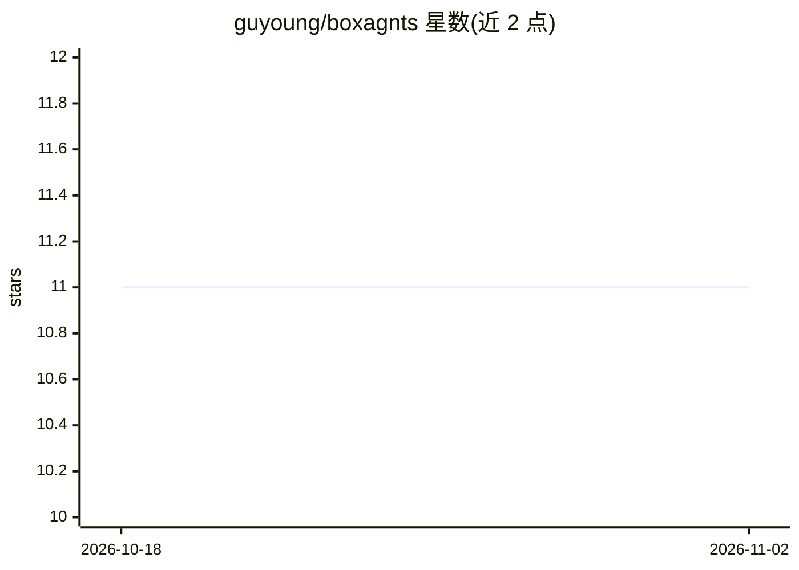

# guyoung/boxagnts

⭐ 11 · JavaScript · MIT · 推送 2026-07-24 · [GitHub](https://github.com/guyoung/boxagnts) · [官网](https://github.com/guyoung/boxagnts) · 个人维护 · 中文 README

**Rust 编写的 AI Agent 工具箱，WASM 沙箱运行自定义工具**

基于 Rust 的 AI Agent ToolBox：提供多模型聊天（20+ 提供商适配）、自定义 Agent 管理、文件/Shell/网页抓取等内置工具、Markdown 驱动的技能系统、Cron 定时任务、静态站点托管与 MCP 协议接入。自定义工具与技能运行于基于 Wasmtime 的 WebAssembly 沙箱中，具备网络访问控制与资源限制；后端使用 Tokio/Axum，前端为 Vue 3 + Vuetify 的 Dashboard。从 Releases 下载可执行文件即可运行，也可用 Rust/Node.js 工具链自行编译。基于 claurst 项目代码开发。

## 筛选速览

| 维度 | 判定 | 备注 |
|---|---|---|
| AI 角色 | `ai-ecosystem` | LLM/agent 周边工具 |
| 许可风险 | `permissive` | MIT |
| 部署形态 | `desktop` | 安装包/桌面程序 |
| 模型依赖 | locked-api |  |
| 硬件要求 | — | 无带数字的原话,不猜 |
| 安装摩擦 | `low` | 无编译、无系统依赖或容器化 |
| 成熟度 | — | 结构信号不足 |

## 能力要点

- 20+ AI 提供商统一适配层（OpenAI/Anthropic/DeepSeek 等）
- WebAssembly 沙箱隔离执行自定义工具，含目录映射、网络控制与资源限制
- 内置工具系统（文件读写、Shell 命令风险解析、网页抓取、文档读取）与 Markdown 驱动的技能系统
- 支持 Cron 定时任务、MCP 协议接入与静态站点托管

## 适用场景

- 通过 Dashboard 与多个 AI 模型对话并管理自定义 Agent
- 在沙箱内安全运行自定义 AI 工具与技能
- 配置定时任务让 Agent 自动执行工作

## 场景标签

`Agent 框架` `聊天机器人` `网页抓取` · 领域:Agent 开发

## 证据(README 行号)

> L11: BoxAgnts is a fully-featured AI Agent toolkit providing:
> L129: - **query/**: Query orchestration engine. Implements the core Agent query loop, including multi-provider dynamic r

## 星数曲线

2026-10-18 11 → 2026-11-02 11（+0）

---
*卡片 v1 · prompt 1.4 · 生成 2026-11-02 · 置信度 high · 依据 README sha `3e6697a6dc36` · [字段定义](../../DATASET.md)*
