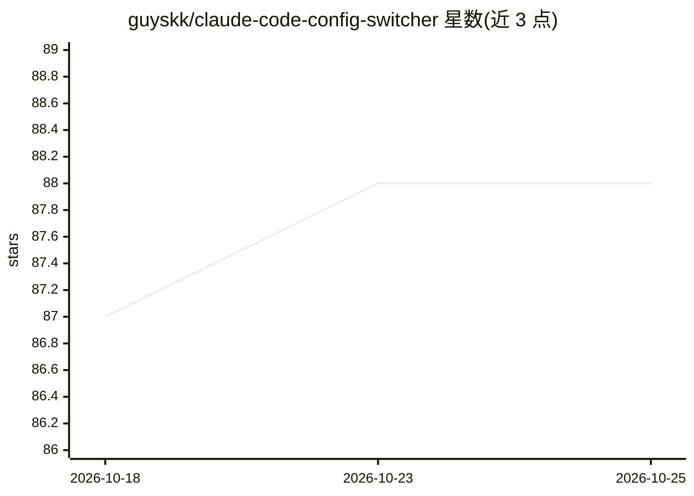

# guyskk/claude-code-config-switcher

⭐ 88 · Go · MIT · 推送 2026-06-15 · [GitHub](https://github.com/guyskk/claude-code-config-switcher) · 个人维护 · 中文 README

**一条命令切换 Claude Code 多供应商配置的 CLI 工具**

ccc 是一个 CLI 工具，用于在 Kimi、GLM、MiniMax 等多个 Claude Code 供应商之间切换。机制上：维护 ~/.claude/ccc.json 配置，将用户 settings.json 与 base 模板、provider 配置深度合并，provider 的 env 通过 --settings 参数传入且优先级高于 settings.json，不修改用户现有配置。提供 ccc validate 校验配置、ccc patch 将系统 claude 命令替换为 ccc。提供 Linux/macOS 二进制一键安装与源码构建（4 个平台）。

## 筛选速览

| 维度 | 判定 | 备注 |
|---|---|---|
| AI 角色 | `ai-ecosystem` | LLM/agent 周边工具 |
| 许可风险 | `permissive` | MIT |
| 部署形态 | `None` |  |
| 模型依赖 | — | README 未给出锁定关系 |
| 硬件要求 | — | 无带数字的原话,不猜 |
| 安装摩擦 | `low` | 无编译、无系统依赖或容器化 |
| 成熟度 | — | 结构信号不足 |

## 能力要点

- 单命令切换 Kimi/GLM/MiniMax 等 Claude Code 供应商
- settings.json 深度合并，保留用户手动编辑、插件与 hooks
- provider env 经 --settings 传入，优先级高于 settings.json 的 env 字段
- ccc validate 配置校验与 ccc patch 命令替换

## 适用场景

- 在不同国内模型供应商之间快速切换 Claude Code 后端
- 保留现有 Claude Code 配置的同时按供应商覆盖端点与密钥
- 校验各供应商配置是否可用

## 场景标签

 · 领域:AI 开发工具/CLI

## 证据(README 行号)

> L13: `ccc` is a CLI tool that provides seamless provider switching for Claude Code. Switch between Kimi, GLM, MiniMax, a
> L65: ## Patch Command: Replace `claude` with `ccc`

## 星数曲线

2026-10-18 87 → 2026-10-25 88（+1）

---
*卡片 v1 · prompt 1.4 · 生成 2026-10-23 · 置信度 high · 依据 README sha `080048b7ef56` · [字段定义](../../DATASET.md)*
