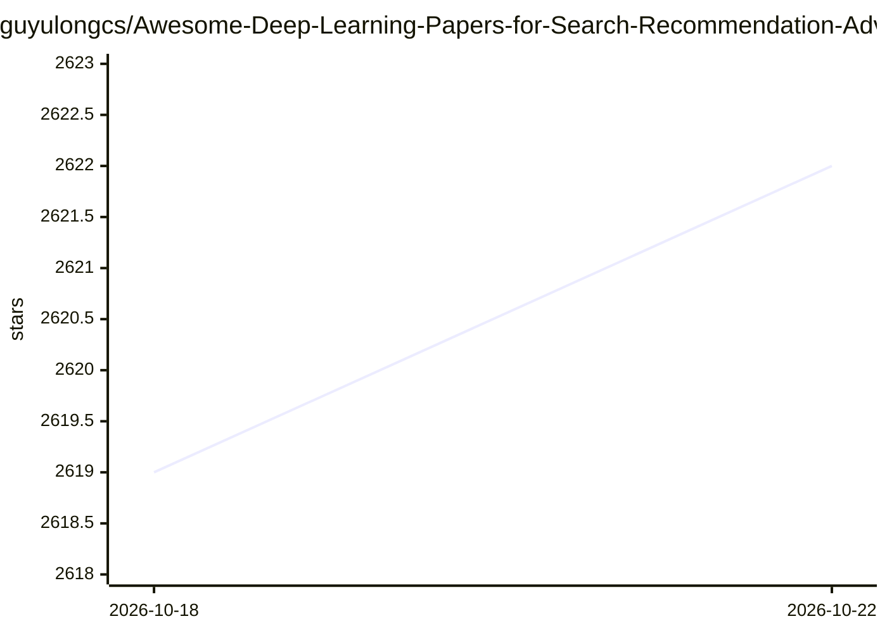

# guyulongcs/Awesome-Deep-Learning-Papers-for-Search-Recommendation-Advertising

⭐ 2,623 · Python · 推送 2026-09-19 · [GitHub](https://github.com/guyulongcs/Awesome-Deep-Learning-Papers-for-Search-Recommendation-Advertising) · 个人维护

**工业搜索/推荐/广告深度学习论文集，按流水线阶段分类**

面向工业界搜索、推荐与广告场景的深度学习论文策展清单，按 Embedding、Matching（召回）、Pre-Ranking、Ranking（CTR/CVR）、Post-Ranking、Relevance-Ranking、LLM 排序、强化学习等流水线阶段组织目录。条目以链接形式指向仓库内的论文 PDF，覆盖 Word2Vec、DeepWalk、DSSM、Two-Tower、Youtube DNN、Airbnb Embedding 等经典工作，并大量收录 Alibaba、Google、Baidu、Facebook 等公司发表于 KDD/CIKM/RecSys/NIPS 等会议的论文。维护者请求引用其发表于 TOIS 2026 的综述论文。

## 筛选速览

| 维度 | 判定 | 备注 |
|---|---|---|
| AI 角色 | `ai-knowledge` | 知识聚合/清单类 |
| 许可风险 | `none` | — |
| 部署形态 | `None` |  |
| 模型依赖 | — | README 未给出锁定关系 |
| 硬件要求 | — | 无带数字的原话,不猜 |
| 安装摩擦 | `low` | 无编译、无系统依赖或容器化 |
| 成熟度 | — | 结构信号不足 |

## 能力要点

- 按 Embedding/Matching/Ranking 等工业流水线阶段组织论文目录
- 收录 1994 至今的工业界论文，附公司来源与发表会议标注
- 论文 PDF 直接存放于仓库内供下载
- 关联维护者自身的 TOIS 综述论文

## 适用场景

- 查找搜索/推荐/广告各阶段的经典与前沿论文
- 按主题系统性学习工业界深度学习排序技术
- 为研究或选型调研收集 CTR/CVR、召回、Embedding 相关文献

## 场景标签

`推荐系统` `科研工具` `精选清单` · 领域:学习与行业

## 证据(README 行号)

> L1: ## Awesome Deep Learning papers for industrial Search, Recommendation and Advertisement. They focus on Embedding, Ma
> L2: #### Please cite our paper: Deep Learning to Rank in Industrial Search Engines, Recommender Systems, and Online Adve
> L7: ## 01_Embedding

## 星数曲线

2026-10-18 2,619 → 2026-10-22 2,622（+3）

---
*卡片 v1 · prompt 1.4 · 生成 2026-10-21 · 置信度 high · 依据 README sha `52aa095c5e23` · [字段定义](../../DATASET.md)*
