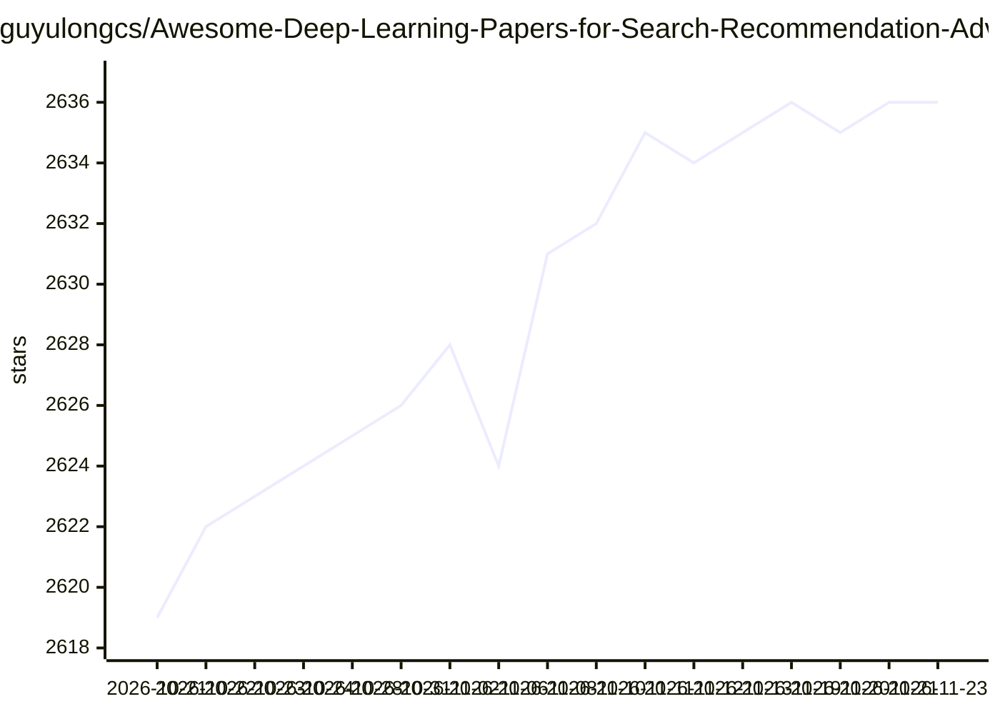

# guyulongcs/Awesome-Deep-Learning-Papers-for-Search-Recommendation-Advertising

⭐ 2,636 · Python · 推送 2026-11-13 · [GitHub](https://github.com/guyulongcs/Awesome-Deep-Learning-Papers-for-Search-Recommendation-Advertising) · 个人维护

**面向搜索/推荐/广告从业者的工业级深度学习排序论文清单**

以论文清单形式组织：收录工业界搜索、推荐与广告场景的深度学习排序论文，按 Embedding、Matching、Pre-Ranking、Ranking（CTR/CVR 预测）、Post-Ranking、Relevance-Ranking、LLM 排序、强化学习等主题分目录，条目附论文 PDF 链接与年份/机构/会议标注，来源包括 Google、Microsoft、Alibaba、Pinterest、Airbnb、Baidu 等公司论文。清单配套同仓库团队发表于 TOIS 2026 的综述论文并请求引用。

## 筛选速览

| 维度 | 判定 | 备注 |
|---|---|---|
| AI 角色 | `ai-knowledge` | 知识聚合/清单类 |
| 许可风险 | `none` | — |
| 部署形态 | `None` |  |
| 模型依赖 | — | README 未给出锁定关系 |
| 硬件要求 | — | 无带数字的原话,不猜 |
| 安装摩擦 | `low` | 无编译、无系统依赖或容器化 |
| 成熟度 | — | 结构信号不足 |

## 能力要点

- 按排序漏斗多阶段（Embedding/Matching/Pre-Ranking/Ranking/Post-Ranking/Relevance）分类组织论文
- 收录 Google/Alibaba/Pinterest/Airbnb/Baidu 等工业界论文，条目附 PDF 链接
- 配套 TOIS 2026 同主题综述论文

## 适用场景

- 检索某一排序阶段（如匹配、粗排）的相关论文
- 调研工业界推荐系统与搜索排序的深度学习方法
- 查阅广告 CTR/CVR 预测方向的公司实践论文

## 场景标签

`精选清单` · 领域:学习与行业

## 证据(README 行号)

> L1: ## Awesome Deep Learning papers for industrial Search, Recommendation and Advertisement. They focus on Embedding, Ma
> L2: #### Please cite our paper: Deep Learning to Rank in Industrial Search Engines, Recommender Systems, and Online Adve
> L4: ## 00_Overview

## 星数曲线

2026-10-21 2,619 → 2026-11-23 2,636（+17）

---
*卡片 v1 · prompt 1.4 · 生成 2026-11-23 · 置信度 high · 依据 README sha `0b1fa48ea82c` · [字段定义](../../DATASET.md)*
