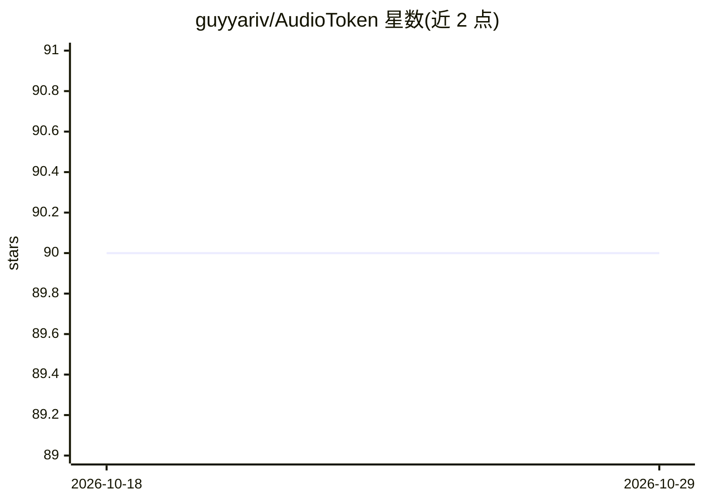

# guyyariv/AudioToken

⭐ 90 · Python · MIT · 推送 2026-05-18 · [GitHub](https://github.com/guyyariv/AudioToken) · [官网](https://pages.cs.huji.ac.il/adiyoss-lab/AudioToken/) · 个人维护

**音频生成图像的 PyTorch 官方实现：文本条件扩散模型适配音频输入**

InterSpeech 2023 论文 AudioToken 的官方 PyTorch 实现：将文本条件潜在扩散模型（Stable Diffusion）适配为以音频录音为条件生成图像。机制为用预训练音频编码模型（BEATs）将音频编码为新 token，作为音频与文本表示之间的适配层，可训练参数量小。提供训练（VGGSound 数据集）与推理脚本，并附带论文所基于的预训练 embedder 权重。面向复现论文或开展音频-图像跨模态生成研究的开发者与科研人员。

## 筛选速览

| 维度 | 判定 | 备注 |
|---|---|---|
| AI 角色 | `ai-native` | 本体是模型或模型工具 |
| 许可风险 | `permissive` | MIT |
| 部署形态 | `library` | 以包/库形式分发 |
| 模型依赖 | — | README 未给出锁定关系 |
| 硬件要求 | — | 无带数字的原话,不猜 |
| 安装摩擦 | `low` | 无编译、无系统依赖或容器化 |
| 成熟度 | — | 结构信号不足 |

## 能力要点

- 利用 BEATs 音频编码器将音频编码为 token 注入文本条件扩散模型
- 少量可训练参数的轻量适配层方法
- 提供训练与推理脚本及预训练 embedder 权重
- 基于 Stable Diffusion v1-4（可选 v2 768x768）

## 适用场景

- 复现论文的音频生成图像实验
- 研究音频与文本表示之间的跨模态适配
- 基于自己的音频数据训练音频条件图像生成模型

## 场景标签

`图像生成` `科研工具` · 领域:内容生成

## 证据(README 行号)

> L1: # [InterSpeech 2023] AudioToken: Adaptation of Text-Conditioned Diffusion Models for Audio-to-Image Generation
> L9: generate images, conditioned on audio recordings. Using a pre-
> L10: trained audio encoding model, the proposed method encodes

## 星数曲线

2026-10-18 90 → 2026-10-29 90（+0）

---
*卡片 v1 · prompt 1.4 · 生成 2026-10-23 · 置信度 mid · 依据 README sha `19f3d6300c90` · [字段定义](../../DATASET.md)*
