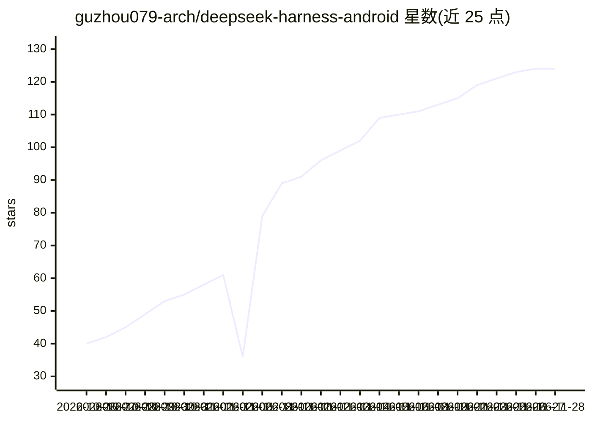

# guzhou079-arch/deepseek-harness-android

⭐ 124 · JavaScript · MIT · 推送 2026-11-24 · [GitHub](https://github.com/guzhou079-arch/deepseek-harness-android) · [官网](https://github.com/guzhou079-arch/deepseek-harness-android/releases) · 个人维护 · 中文 README

**把 DeepSeek Harness 打包成免 root 直装的安卓 APK**

DeepSeek Harness 的安卓移植增强版：通过 APK 安装后填 API Key 即可使用，无需 Termux、root 或电脑。基于上游安卓壳骨架叠加 25 条适配补丁，提供无障碍读屏/点击/输入、虚拟屏中操作其他 App、通知读取、定时任务，27 款技能随包；特色是在手机内完成 javac→d8→打包→签名→发版的自构建链路（构建环境约 193MB 按需下载）。需 Android 8.0+，仅可从本仓库 Releases 更新以免签名冲突丢数据。

## 筛选速览

| 维度 | 判定 | 备注 |
|---|---|---|
| AI 角色 | `ai-native` | 本体是模型或模型工具 |
| 许可风险 | `permissive` | MIT |
| 部署形态 | `None` |  |
| 模型依赖 | locked-api |  |
| 硬件要求 | — | 无带数字的原话,不猜 |
| 安装摩擦 | `medium` | 含编译或系统依赖之一 |
| 成熟度 | — | 结构信号不足 |

## 能力要点

- 27 款技能随包（本地 RAG、Office 批处理、深度调研等）
- 虚拟屏运行 AI 任务，主屏不受占用
- 手机内自构建：javac→d8→重打包→签名→发版
- 25 条安卓适配补丁含 Shizuku 特权通道与安全加固

## 适用场景

- 在手机上让 AI 读取屏幕并代替操作其他 App
- 手机端跑定时任务和本地 RAG 等离线能力
- 不用电脑即可在手机上构建、签名并发布 APK

## 场景标签

`RAG` `GUI 自动化` `AI 助手` · 领域:效率与自动化

## 证据(README 行号)

> L17: **DeepSeek Harness 装进安卓：一个 APK，不用 Termux、不用 root、不用电脑。**
> L36: |📱 **手机自动化**|无障碍读屏 / 点击 / 输入、虚拟屏、通知读取、定时任务；AI 在虚拟屏里干活，你的主屏照常用|
> L131: |项目|**@deepseek-ai/dsh**（DeepSeek Harness）|

## 星数曲线

2026-10-26 40 → 2026-11-28 124（+84）

---
*卡片 v1 · prompt 1.4 · 生成 2026-11-28 · 置信度 high · 依据 README sha `6ddd81b1558d` · [字段定义](../../DATASET.md)*
