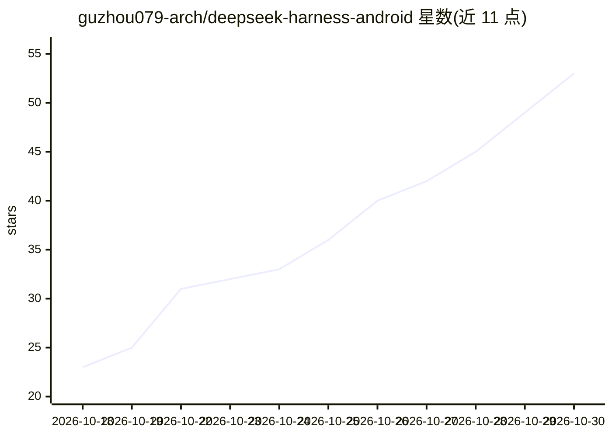

# guzhou079-arch/deepseek-harness-android

⭐ 53 · Java · MIT · 推送 2026-10-27 · [GitHub](https://github.com/guzhou079-arch/deepseek-harness-android) · [官网](https://github.com/guzhou079-arch/deepseek-harness-android/releases) · 个人维护 · 中文 README

**DeepSeek Harness 的安卓 APK 移植版，手机上跑 AI 自动化与自编译发版**

把 DeepSeek Harness 打包为可直接安装的安卓 APK：读屏、点击、输入、虚拟屏、通知读取与定时任务均在 App 内运行，随包含 21 款技能（本地 RAG、Office 批处理、语音交互等），填入模型 API Key 即可使用。相对上游安卓壳骨架加入 25 条适配补丁与界面改造；另支持在手机内完成 javac→d8→重打包→签名→发版的完整出包链路（构建环境约 193MB 按需下载）。虚拟屏实现移植自 Operit（LGPL-3.0），引擎内核来自 deepseek-ai/dsh。

## 筛选速览

| 维度 | 判定 | 备注 |
|---|---|---|
| AI 角色 | `ai-native` | 本体是模型或模型工具 |
| 许可风险 | `permissive` | MIT |
| 部署形态 | `None` |  |
| 模型依赖 | locked-api |  |
| 硬件要求 | — | 无带数字的原话,不猜 |
| 安装摩擦 | `medium` | 含编译或系统依赖之一 |
| 成熟度 | — | 结构信号不足 |

## 能力要点

- 无障碍读屏/点击/输入、虚拟屏、通知读取、定时任务在 App 内运行
- 21 款技能随包，填 API Key 即用，无需 Termux/root/电脑
- 手机内完成 javac→d8→重打包→签名→发版的自身出包链路
- Release 提供 SHA-256 校验与国内加速直链

## 适用场景

- 在安卓手机上不装 Termux 直接使用 DeepSeek Harness 的 AI 自动化能力
- 让 AI 在虚拟屏里操作其他 App，主屏不受干扰
- 在手机上修改代码后自行编译、签名并发布新版 APK

## 场景标签

`GUI 自动化` · 领域:效率与自动化

## 证据(README 行号)

> L14: 读屏、点击、输入、虚拟屏、定时任务都在 App 内跑，21 款技能随包，装上填个 API Key 就能用。
> L25: |🧩 **21 款技能随包**|架构图 · 演示稿 · 短视频分镜 · 记忆中枢 · Office 批处理 · Word/公文 · Excel 多表 · 会议纪要 · 邮件公函 · 本地 RAG · 全站备份 · 跨厂商会审 · 
> L66: 本发布包是 **DeepSeek Harness 的安卓移植与增强版**，由个人制作。

## 星数曲线

2026-10-18 23 → 2026-10-30 53（+30）

---
*卡片 v1 · prompt 1.4 · 生成 2026-10-25 · 置信度 high · 依据 README sha `8b2b9a9332e9` · [字段定义](../../DATASET.md)*
