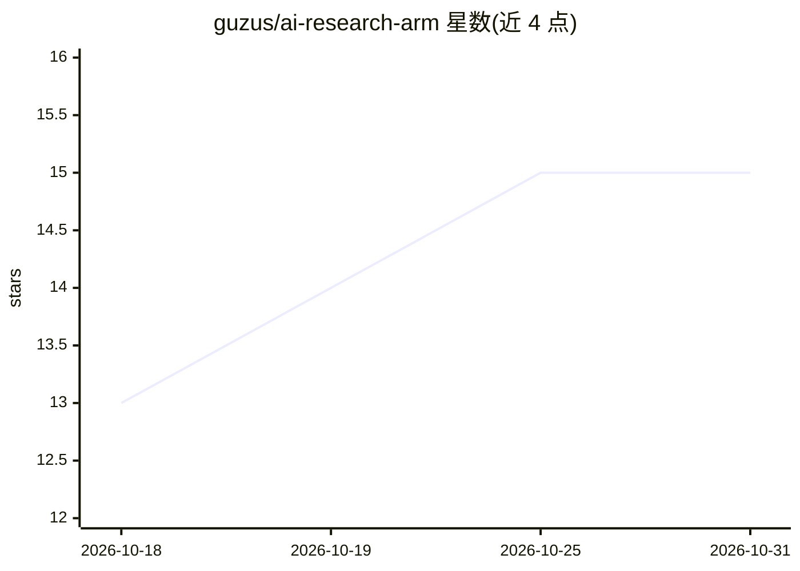

# guzus/ai-research-arm

⭐ 15 · HTML · MIT · 推送 2026-10-30 · [GitHub](https://github.com/guzus/ai-research-arm) · [官网](https://ara.guzus.xyz) · 个人维护

**自动运行的 AI 新闻情报管线：多源 agent 采集并自动出版日报与维基**

由 32 个 GitHub Actions workflow 编排的 AI 新闻管线：LLM agent 定时读取 Twitter/X、RSS、Hacker News、Reddit、Bluesky、arXiv、专家博客与 YouTube，每日生成综合日报（含 TTS 音频）、报纸式首页、模型发布时间线与持续累积的 LLM 维基，按需生成长篇带引用文章并推送 Telegram 头条警报。后端模型按 lane 路由（data/agent-backends.json 单一事实源，claude→zai-glm 回退链），带输出契约、沙箱与失效关闭发布机制。仓库内含样例数据，可无 API key 运行仪表盘（Bun/uv）；完整数据管线需自备凭据。

## 筛选速览

| 维度 | 判定 | 备注 |
|---|---|---|
| AI 角色 | `ai-native` | 本体是模型或模型工具 |
| 许可风险 | `permissive` | MIT |
| 部署形态 | `self-host` | docker 或自建部署 |
| 模型依赖 | — | README 未给出锁定关系 |
| 硬件要求 | — | 无带数字的原话,不猜 |
| 安装摩擦 | `low` | 无编译、无系统依赖或容器化 |
| 成熟度 | — | 结构信号不足 |

## 能力要点

- 多源读取（Twitter/RSS/HN/Reddit/Bluesky/arXiv/YouTube 等）自动合成日报、首页与维基
- 32 个 GitHub Actions workflow 编排，产物提交进 git 可 diff 审计
- 单文件后端路由（claude→zai-glm-5p3 回退链），CI 校验文档不漂移
- 输出契约 + 沙箱 agent + 失效关闭发布（fail-closed publishing）

## 适用场景

- 无人值守地跟踪 AI 领域新闻并自动出版日报与首页
- 维护持续累积、带不变 slug 的模型发布时间线与实体维基
- 通过 issue/推文 URL 按需委托生成经验证的引用文章

## 场景标签

`网页抓取` `AI 写作` · 领域:效率与自动化

## 证据(README 行号)

> L5: **The AI newspaper that writes itself.** Every few hours, a fleet of LLM agents
> L7: expert blogs, YouTube. Every night it writes the paper: a synthesized digest, a
> L104: `data/agent-backends.json`. `agent-run` lanes

## 星数曲线

2026-10-18 13 → 2026-10-31 15（+2）

---
*卡片 v1 · prompt 1.4 · 生成 2026-10-30 · 置信度 mid · 依据 README sha `475ade8953f6` · [字段定义](../../DATASET.md)*
