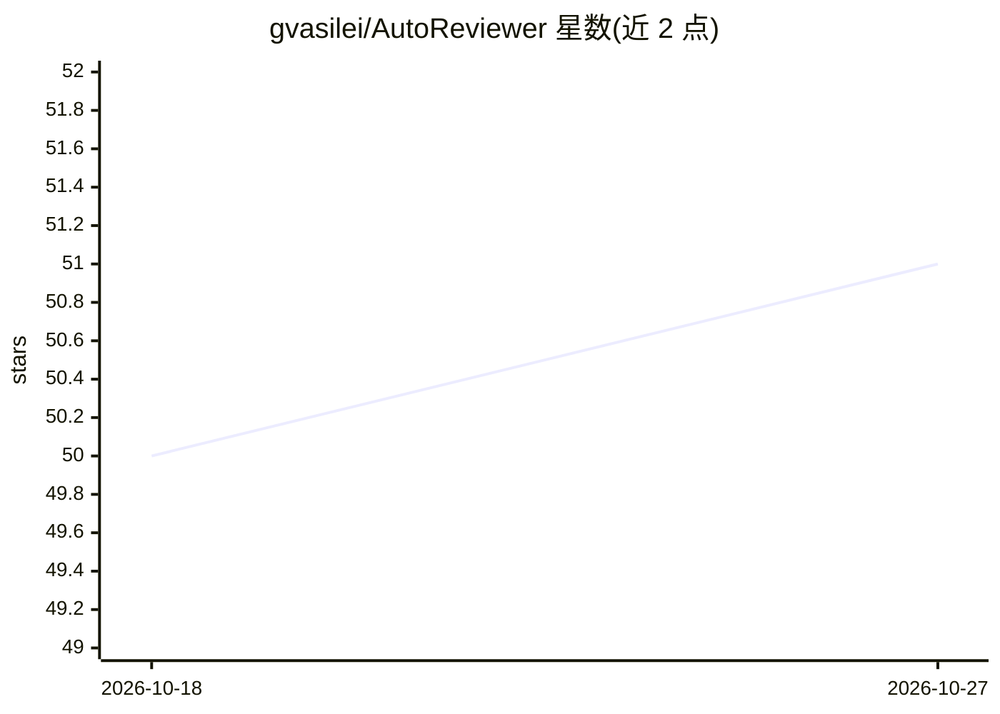

# gvasilei/AutoReviewer

⭐ 51 · TypeScript · MIT · 推送 2026-06-22 · [GitHub](https://github.com/gvasilei/AutoReviewer) · 个人维护

**用 OpenAI 模型做自动代码评审的 GitHub Action**

一个在 PR 上运行的 GitHub Action：调用 OpenAI API（默认 gpt-3.5-turbo，可选 gpt-4）对拉取请求的代码变更生成评审意见。LLM 集成基于 Effect AI 构建，输入参数与 OpenAI 支持的原版本保持一致，支持设定模型温度、用通配符排除文件（如 *.md）。使用需将 OpenAI API key 配置为 GitHub secret。README 声明项目仍在早期开发阶段，并注明 gpt-4 的建议质量更好。

## 筛选速览

| 维度 | 判定 | 备注 |
|---|---|---|
| AI 角色 | `ai-native` | 本体是模型或模型工具 |
| 许可风险 | `permissive` | MIT |
| 部署形态 | `None` |  |
| 模型依赖 | — | README 未给出锁定关系 |
| 硬件要求 | — | 无带数字的原话,不猜 |
| 安装摩擦 | `low` | 无编译、无系统依赖或容器化 |
| 成熟度 | `idea` | |

## 能力要点

- 在 pull_request 事件或标签触发时自动运行代码评审
- 支持 gpt-4 与 gpt-3.5-turbo，可配置模型温度
- 通配符排除文件（如 *.md），支持逗号分隔多个表达式
- LLM 集成基于 Effect AI（Effect-TS）构建

## 适用场景

- 每次 PR 自动获得 LLM 生成的代码评审意见
- 通过标签手动触发特定 PR 的 AI 评审
- 排除文档等文件让评审聚焦代码变更

## 场景标签

`代码审查` · 领域:编码与开发

## 证据(README 行号)

> L3: A GitHub action that uses OpenAI models to perform automated code reviews. The action's LLM integration is built wit
> L33: |model_name|False|gpt-3.5-turbo|OpenAI model name. Common choices include `gpt-4` and `gpt-3.5-turbo`|

## 星数曲线

2026-10-18 50 → 2026-10-27 51（+1）

---
*卡片 v1 · prompt 1.4 · 生成 2026-10-24 · 置信度 high · 依据 README sha `4b568d7e91e7` · [字段定义](../../DATASET.md)*
