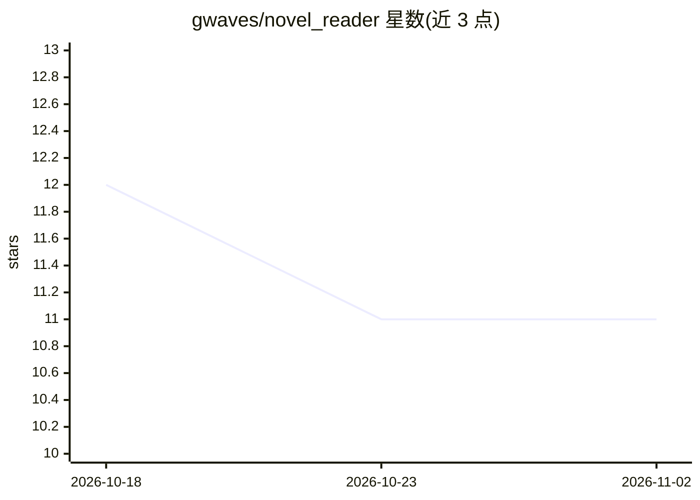

# gwaves/novel_reader

⭐ 11 · JavaScript · MIT · 推送 2026-07-18 · [GitHub](https://github.com/gwaves/novel_reader) · 组织维护 · 中文 README

**AI 原生长篇小说阅读器：知识图谱+RAG+多角色有声书**

面向长篇小说读者的本地优先阅读系统：PC 端导入 TXT/EPUB/文本型 PDF，生成章节概要、人物关系知识图谱和 RAG 检索索引，支持跨章节问答并保留来源；生产流水线批量生成 embedding、按全书固定选角的多角色 MP3（MIMO/火山引擎 Seed TTS 2.0 双 Provider）；Gateway 提供云端分发与管理后台，Android App 支持离线读听与锁屏续播。扫描型 PDF 需先 OCR；移动端不保存上游密钥。

## 筛选速览

| 维度 | 判定 | 备注 |
|---|---|---|
| AI 角色 | `ai-native` | 本体是模型或模型工具 |
| 许可风险 | `permissive` | MIT |
| 部署形态 | `library` | 以包/库形式分发 |
| 模型依赖 | — | README 未给出锁定关系 |
| 硬件要求 | — | 无带数字的原话,不猜 |
| 安装摩擦 | `low` | 无编译、无系统依赖或容器化 |
| 成熟度 | — | 结构信号不足 |

## 能力要点

- 自动抽取人物/门派/道具/事件等实体并保留证据章节，支持编辑与 GraphML 导出
- 概要+正文 chunk+图谱实体三路召回的 RAG 跨章节问答
- MIMO 与火山引擎 Seed TTS 2.0 双 Provider 多角色有声书合成，全书固定选角
- 持久生产队列、断点续跑与分层故障救援

## 适用场景

- 读超长网文时查人物关系、追伏笔和剧情前因后果
- 把整本小说转成分角色有声书并同步到手机离线听
- 在移动端离线阅读、搜索和锁屏连续听书

## 场景标签

`语音合成` `知识图谱` `文档问答` · 领域:内容生成

## 证据(README 行号)

> L5: AI 原生的小说阅读器：把长篇小说变成可检索、可追踪、可听的智能阅读体验。它不仅能导入和阅读本地书库，还会为整本书生成知识图谱、RAG 检索索引和多角色有声小说音频，让读者可以一边读正文，一边查人物关系、追剧情伏笔、听接近“原声剧”
> L19: |RAG 剧情问答|基于概要、正文 chunk 和图谱实体召回，回答跨章节问题并保留来源依据|
> L83: - **RAG 跨章节问答**：融合章节概要、正文 chunk 和图谱实体召回，适合追踪人物首次出现、道具流转、伏笔回收和剧情前因后果。

## 星数曲线

2026-10-18 12 → 2026-11-02 11（-1）

---
*卡片 v1 · prompt 1.4 · 生成 2026-11-02 · 置信度 high · 依据 README sha `003ea9cf3483` · [字段定义](../../DATASET.md)*
