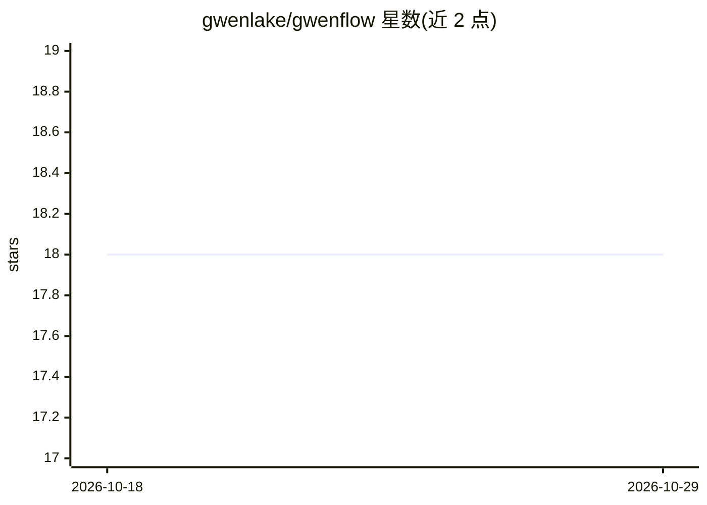

# gwenlake/gwenflow

⭐ 18 · Python · MIT · 推送 2026-10-27 · [GitHub](https://github.com/gwenlake/gwenflow) · [官网](https://gwenlake.com) · 组织维护

**给开发者的 LLM 与自主 Agent 应用编排框架**

Gwenlake 开发的 Python 框架，用于构建基于 LLM 与 Agent 的应用：提供统一 API 接入 OpenAI/Anthropic/Azure/Mistral/Google/Ollama/DeepSeek 等多家模型，支持工具调用的自主 Agent 循环、结构化输出（Pydantic 模型）、多 Agent 团队委派与 DAG 流水线（代码或 YAML 定义）。内置 RAG 管道、分层的上下文压缩（保持 prompt cache 有效）、基于 OpenTelemetry 的可选遥测。附带沙箱工具的 CodingAgent 与按需加载的 Skills 机制。pip 安装，MIT 许可。

## 筛选速览

| 维度 | 判定 | 备注 |
|---|---|---|
| AI 角色 | `ai-ecosystem` | LLM/agent 周边工具 |
| 许可风险 | `permissive` | MIT |
| 部署形态 | `library` | 以包/库形式分发 |
| 模型依赖 | local-ok | 支持本地模型 |
| 硬件要求 | — | 无带数字的原话,不猜 |
| 安装摩擦 | `low` | 无编译、无系统依赖或容器化 |
| 成熟度 | — | 结构信号不足 |

## 能力要点

- 多家 LLM 提供商统一 API，含本地 Ollama 与推理内容暴露
- 自主 Agent 循环、多 Agent 委派与 DAG 流水线（代码/YAML）
- 分层上下文压缩，长任务不超窗口且保持前缀缓存有效
- OpenTelemetry 遥测默认关闭、零开销，可接入任意 OTLP 后端

## 适用场景

- 用统一 API 构建跨多家模型提供商的 Agent 应用
- 以 DAG 流水线编排多 Agent 协作流程
- 构建带沙箱文件/shell 工具的编码 Agent

## 场景标签

`Agent 框架` `多智能体` `RAG` · 领域:Agent 开发

## 证据(README 行号)

> L3: **A framework for orchestrating applications powered by autonomous AI agents and LLMs.**
> L10: Gwenflow, a framework designed by Gwenlake, streamlines the creation of customized, production-ready applications b
> L15: - **Multi-agent flows** — DAG-based pipelines defined in code or YAML

## 星数曲线

2026-10-18 18 → 2026-10-29 18（+0）

---
*卡片 v1 · prompt 1.4 · 生成 2026-10-29 · 置信度 high · 依据 README sha `ec6e0f8cc2df` · [字段定义](../../DATASET.md)*
