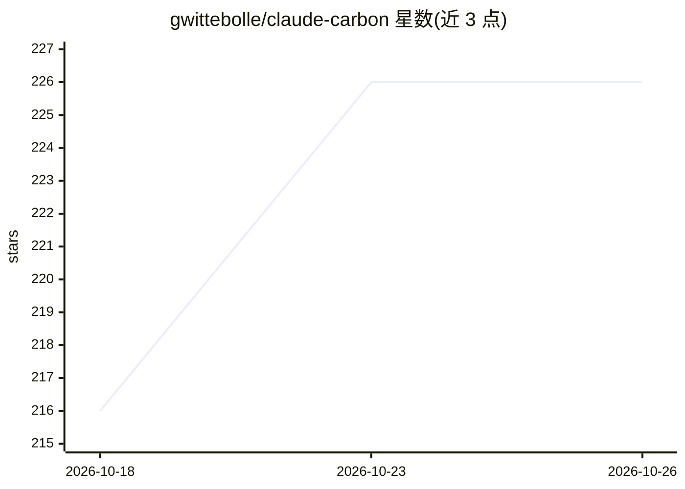

# gwittebolle/claude-carbon

⭐ 226 · Shell · MIT · 推送 2026-10-21 · [GitHub](https://github.com/gwittebolle/claude-carbon) · [官网](https://tokenclimate.com) · 个人维护

**追踪 Claude Code 会话碳排放的插件：终端与桌面端实时 CO2**

开源 Claude Code 插件，从 token 用量在本地计算会话 CO2 估计值，显示在终端状态行与 Claude 桌面应用 Code 标签页，并显示 API 等效费用。桌面端 /carbon-panel 打开含像素分子、使用趋势与 warming stripes 的面板；每个会话持久化到本地 SQLite，可从 ~/.claude 旧记录回填历史。提供 /carbon-report（文本）、/carbon-card（PNG，需本机 Chrome/Edge 或降级为 HTML）、/carbon-pr（PR 碳足迹）等命令。限制：仅覆盖本地运行的 Code 会话，Chat/Cowork 标签与网页版不计。

## 筛选速览

| 维度 | 判定 | 备注 |
|---|---|---|
| AI 角色 | `ai-ecosystem` | LLM/agent 周边工具 |
| 许可风险 | `permissive` | MIT |
| 部署形态 | `desktop` | 安装包/桌面程序 |
| 模型依赖 | — | README 未给出锁定关系 |
| 硬件要求 | — | 无带数字的原话,不猜 |
| 安装摩擦 | `low` | 无编译、无系统依赖或容器化 |
| 成熟度 | — | 结构信号不足 |

## 能力要点

- 状态行实时 CO2 估计与 API 等效费用
- 会话数据持久化到本地 SQLite 并可回填历史记录
- /carbon-report、/carbon-card（PNG 报告卡）、/carbon-pr 等斜杠命令
- 5h 配额百分比直接读取 Anthropic /api/oauth/usage 端点

## 适用场景

- 查看每次 Claude Code 会话的碳排放与等效费用
- 生成月度/年度 CO2 报告卡并分享
- 统计一个拉取请求开发过程的碳足迹

## 场景标签

 · 领域:开发者工具/AI 可持续性

## 证据(README 行号)

> L9: claude-carbon is an open source Claude Code plugin that tracks the carbon footprint of your sessions: a live CO2 est
> L17: - Persists each session to a local SQLite database, so history survives the 30-day transcript purge
> L19: - Slash commands: `/carbon-report` (text), `/carbon-card` (PNG), `/carbon-pr` (footprint of a pull request)

## 星数曲线

2026-10-18 216 → 2026-10-26 226（+10）

---
*卡片 v1 · prompt 1.4 · 生成 2026-10-22 · 置信度 high · 依据 README sha `3e5ea7b828ac` · [字段定义](../../DATASET.md)*
