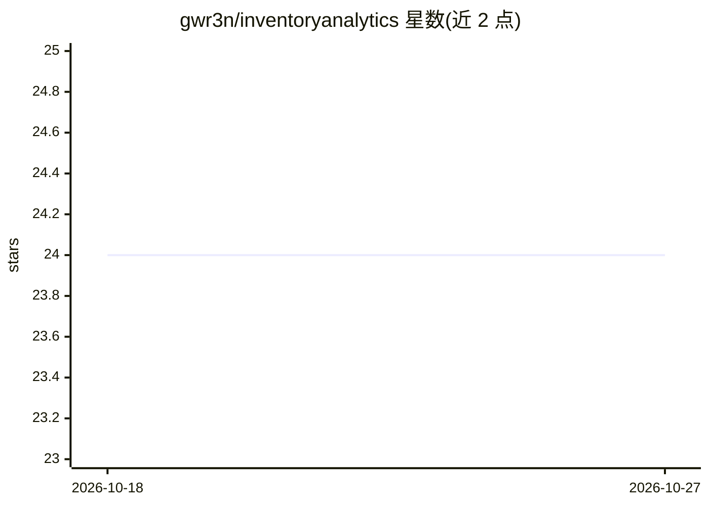

# gwr3n/inventoryanalytics

⭐ 24 · Python · MIT · 推送 2026-08-07 · [GitHub](https://github.com/gwr3n/inventoryanalytics) · [官网](https://www.openbookpublishers.com/product/1399) · 个人维护

**库存分析与预测的 Python 算法库（含 CLI）**

面向库存管理与运筹场景的 Python 库，实现预测与库存控制算法（如批量定价/库存优化），支持 Python 3.8–3.13，通过 pip 从源码安装。提供命令行接口：用 -list 列出算法目录，-method 选择具体算法，输入输出均为 JSON，也可通过 python -m 调用。附构建指引与引用条目，作者 Roberto Rossi。

## 筛选速览

| 维度 | 判定 | 备注 |
|---|---|---|
| AI 角色 | `ai-ecosystem` | LLM/agent 周边工具 |
| 许可风险 | `permissive` | MIT |
| 部署形态 | `library` | 以包/库形式分发 |
| 模型依赖 | — | README 未给出锁定关系 |
| 硬件要求 | — | 无带数字的原话,不猜 |
| 安装摩擦 | `low` | 无编译、无系统依赖或容器化 |
| 成熟度 | — | 结构信号不足 |

## 能力要点

- 实现预测与库存控制算法目录
- CLI 列出可用算法并按方法调用（如 els）
- JSON 输入输出，支持 python -m 调用
- 支持 Python 3.8–3.13

## 适用场景

- 库存管理与批量订货问题的算法计算
- 在 Python 中集成库存预测与优化方法
- 通过命令行以 JSON 交互运行库存算法

## 场景标签

 · 领域:运筹/库存分析

## 证据(README 行号)

> L1: A Python library dedicated to Inventory Analytics.
> L17: The CLI provides a curated catalog of the forecasting and inventory-control

## 星数曲线

2026-10-18 24 → 2026-10-27 24（+0）

---
*卡片 v1 · prompt 1.4 · 生成 2026-10-27 · 置信度 mid · 依据 README sha `c017784122d2` · [字段定义](../../DATASET.md)*
