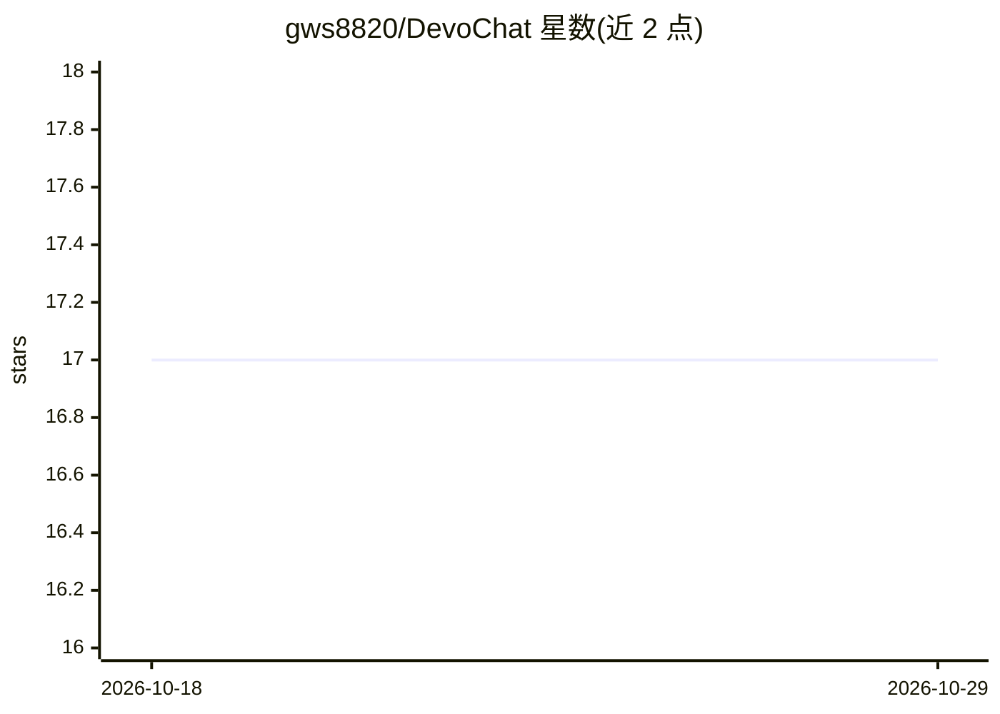

# gws8820/DevoChat

⭐ 17 · JavaScript · MIT · 推送 2026-07-23 · [GitHub](https://github.com/gws8820/DevoChat) · [官网](https://devochat.com) · 个人维护

**统一 Web AI 聊天平台：单一界面调用多模型并接入 MCP 工具**

基于 React + FastAPI + MongoDB 的 Web 应用：通过统一会话架构在对话中切换多家多模态 AI 模型（对话、文生图/图生图、实时语音 STS），以 JSON 配置即可新增模型而无需改代码；内置 Web 端 MCP 客户端，可从浏览器直连 SSE/本地 MCP 服务器（本地经 secure-mcp-proxy），并可视化监控工具调用。安装需分别部署前后端并配置 MongoDB 等环境变量，模型接入依赖各 provider 的 API。面向需要自建多模型聊天界面的开发者/个人用户。

## 筛选速览

| 维度 | 判定 | 备注 |
|---|---|---|
| AI 角色 | `ai-native` | 本体是模型或模型工具 |
| 许可风险 | `permissive` | MIT |
| 部署形态 | `library` | 以包/库形式分发 |
| 模型依赖 | — | README 未给出锁定关系 |
| 硬件要求 | — | 无带数字的原话,不猜 |
| 安装摩擦 | `low` | 无编译、无系统依赖或容器化 |
| 成熟度 | — | 结构信号不足 |

## 能力要点

- MongoDB 统一会话架构，对话中切换模型不丢上下文
- JSON 配置即可新增模型，支持 reasoning/web_search/research 的 toggle/switch 变体
- 浏览器直连 SSE/本地 MCP 服务器（经 secure-mcp-proxy），实时监控工具调用
- 支持文生图/图生图模型与 RealTime API 语音对话

## 适用场景

- 在一个界面里使用多家 AI 模型进行对话、生图与实时语音
- 让 AI 通过 MCP 调用 GitHub、arxiv 等外部工具
- 自部署一个可按 JSON 灵活增删模型的聊天平台

## 场景标签

`聊天机器人` `语音 Agent` `图像生成` · 领域:对话与助手

## 证据(README 行号)

> L6: DevoChat is a web application that allows you to use various multimodal AI models and tools through a single interfa
> L78:  - Connects directly to all types of MCP servers (SSE, Local) from web browsers.

## 星数曲线

2026-10-18 17 → 2026-10-29 17（+0）

---
*卡片 v1 · prompt 1.4 · 生成 2026-10-29 · 置信度 high · 依据 README sha `5e238f06609a` · [字段定义](../../DATASET.md)*
