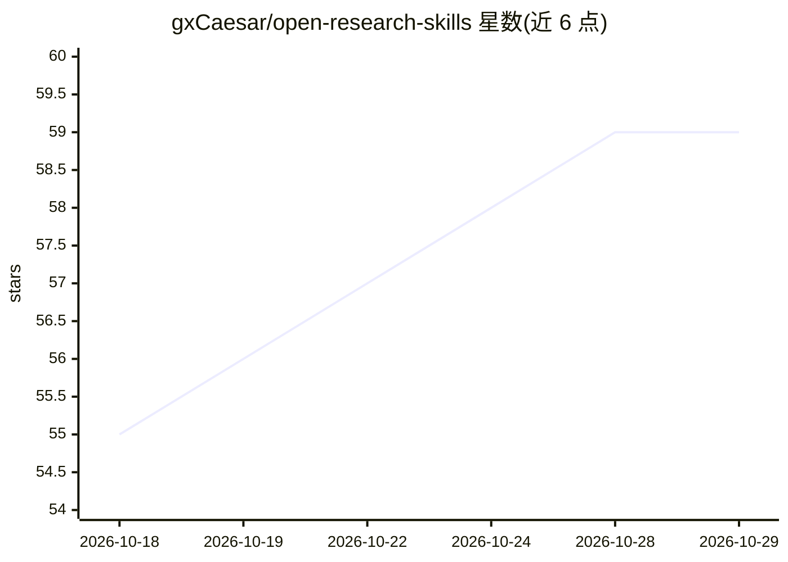

# gxCaesar/open-research-skills

⭐ 59 · Python · Apache-2.0 · 推送 2026-09-23 · [GitHub](https://github.com/gxCaesar/open-research-skills) · [官网](https://github.com/gxCaesar/open-research-skills#tasks) · 个人维护 · 中文 README

**科研全流程的十个可独立安装 agent skill 工具箱**

在一个仓库中维护十个面向科研的 agent skill，覆盖科研绘图（可编辑 PPTX/矢量导出）、会议论文（AAAI/ICLR/NeurIPS 等适配器、draft/polish/audit/rebuttal/camera-ready 模式）、期刊论文（含 Nature 系列）、基金 proposal、研究工作流、调研与新颖性审计、方法迭代到 SOTA、冷审 panel、受邀审稿与代码数据发布。每个 skill 为自足目录，可单独安装；支持 Claude Code 插件两行安装，也可复制到 Codex、Antigravity CLI 及其他兼容 runtime 的 skill 目录。教程以 AI 与生物研究为主，明确不配置账号或模型服务。

## 筛选速览

| 维度 | 判定 | 备注 |
|---|---|---|
| AI 角色 | `ai-ecosystem` | LLM/agent 周边工具 |
| 许可风险 | `permissive` | Apache-2.0 |
| 部署形态 | `library` | 以包/库形式分发 |
| 模型依赖 | locked-api |  |
| 硬件要求 | — | 无带数字的原话,不猜 |
| 安装摩擦 | `low` | 无编译、无系统依赖或容器化 |
| 成熟度 | — | 结构信号不足 |

## 能力要点

- 十个 skill 各为自足目录，可单独安装、独立使用
- Claude Code 插件市场两行装齐，命名空间与个人同名 skill 共存
- 支持 Codex、Antigravity CLI 等多种 runtime 的项目级/全局级安装
- 会议论文 skill 提供按会议区分的适配器与多任务模式

## 适用场景

- 从方法说明生成可编辑的科研架构图与机制图
- 用 agent 逐节起草、打磨顶会论文并处理 rebuttal
- 投稿前让 agent 以冷审 panel 角色审查自己的论文
- 组织基金 proposal 材料与章节 brief

## 场景标签

`科研工具` `AI 写作` · 领域:内容生成

## 证据(README 行号)

> L13: 这是一个面向日常科研的 agent skill 工具箱。十个完整 skill 在一个仓库中维护，每个都能单独安装、独立使用。您可以从一张图、一段 Results 或一个研究问题开始，不必先启动整套研究流程。
> L154: |**其他 runtime**（含由 DeepSeek 等模型驱动的 harness）|每个 skill 都是自足目录：把 `skills/<name>/` 整个复制到该 harness 读取 skill 或项目上下文的位置。支

## 星数曲线

2026-10-18 55 → 2026-10-29 59（+4）

---
*卡片 v1 · prompt 1.4 · 生成 2026-10-24 · 置信度 mid · 依据 README sha `029f71f910b8` · [字段定义](../../DATASET.md)*
