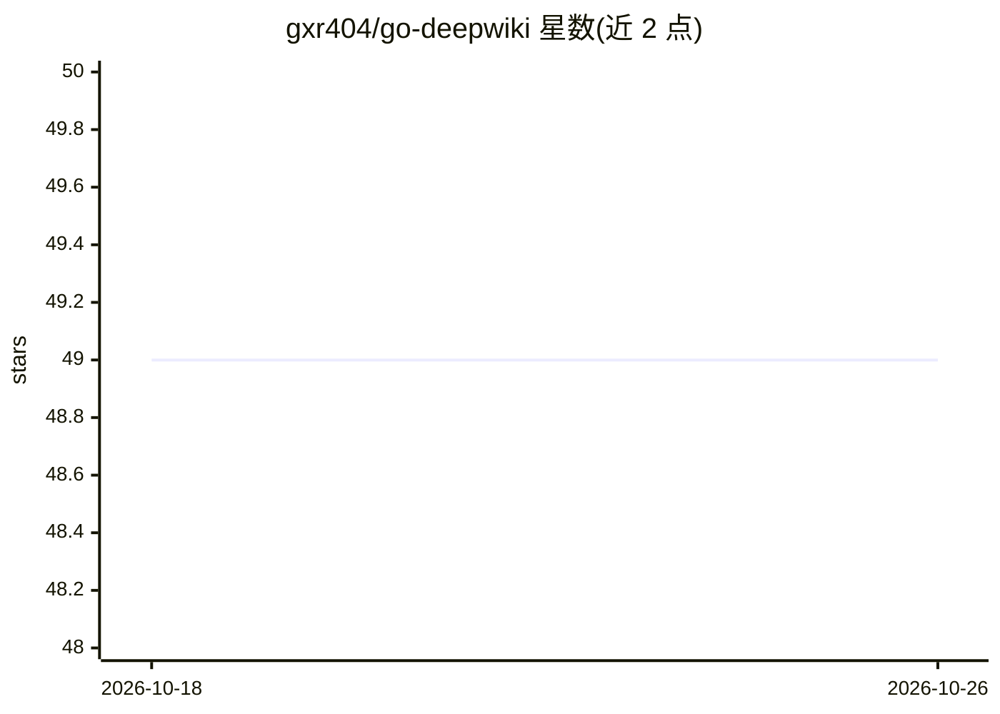

# gxr404/go-deepwiki

⭐ 49 · JavaScript · 推送 2026-01-01 · [GitHub](https://github.com/gxr404/go-deepwiki) · [官网](https://greasyfork.org/zh-CN/scripts/534059-github-go-deepwiki) · 个人维护 · 中文 README

**油猴脚本：在 GitHub 页面添加跳转 DeepWiki 按钮**

一个 Tampermonkey 油猴脚本，在 GitHub 仓库页面上添加跳转 DeepWiki 的按钮，用于快速查看对应仓库的 DeepWiki 文档。安装需先装 Tampermonkey 浏览器插件，再从 Greasy Fork 安装脚本；不装油猴插件的用户可改用其提供的 Chrome 扩展（github-deepwiki）。README 仅含安装步骤与预览，未说明更多机制或限制。

## 筛选速览

| 维度 | 判定 | 备注 |
|---|---|---|
| AI 角色 | `ai-ecosystem` | LLM/agent 周边工具 |
| 许可风险 | `none` | — |
| 部署形态 | `None` |  |
| 模型依赖 | — | README 未给出锁定关系 |
| 硬件要求 | — | 无带数字的原话,不猜 |
| 安装摩擦 | `low` | 无编译、无系统依赖或容器化 |
| 成熟度 | — | 结构信号不足 |

## 能力要点

- 在 GitHub 页面提供跳转 DeepWiki 的入口按钮
- 支持通过 Tampermonkey 油猴脚本安装
- 提供不依赖油猴插件的 Chrome 扩展替代方案

## 适用场景

- 浏览 GitHub 仓库时快速跳转查看该仓库的 DeepWiki 文档
- 偏好油猴脚本或 Chrome 扩展的用户按各自方式安装使用

## 场景标签

 · 领域:开发者工具/浏览器扩展

## 证据(README 行号)

> L3: github 跳转 deepwiki 的油猴脚本
> L7: 1. 安装tampermonkey浏览器插件

## 星数曲线

2026-10-18 49 → 2026-10-26 49（+0）

---
*卡片 v1 · prompt 1.4 · 生成 2026-10-24 · 置信度 mid · 依据 README sha `8c9218ebbd25` · [字段定义](../../DATASET.md)*
