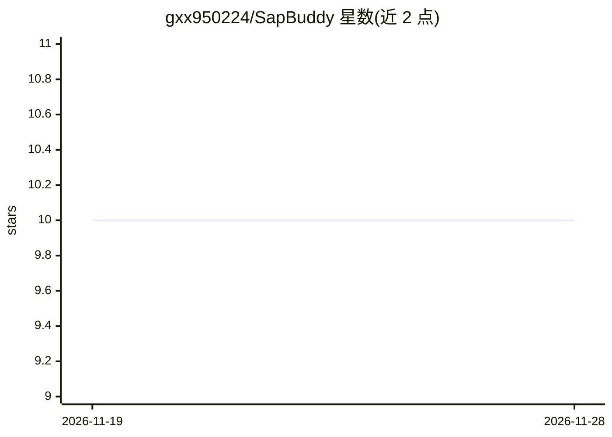

# gxx950224/SapBuddy

⭐ 10 · JavaScript · MIT · 推送 2026-10-28 · [GitHub](https://github.com/gxx950224/SapBuddy) · 个人维护 · 中文 README

**SAP ABAP 开发顾问的自然语言 AI 助手 CLI**

面向 SAP 开发顾问与业务顾问的 CLI/Web 工具，通过自然语言调用 41 个内置 SAP 工具：对象搜索、源码读取、代码开发与审查、ATC 质量检查、单元测试、SQL 查询、DDIC 管理等。经 abap-adt-api 走 ADT HTTPS 接口连接 SAP。安全机制包括默认只读、开发客户端守卫（检查 T000.CCCATEGORY）、写前 diff 审核门禁与审计日志。支持接入外部 MCP 服务器，会话框架基于 pi-coding-agent 构建。

## 筛选速览

| 维度 | 判定 | 备注 |
|---|---|---|
| AI 角色 | `ai-native` | 本体是模型或模型工具 |
| 许可风险 | `permissive` | MIT |
| 部署形态 | `library` | 以包/库形式分发 |
| 模型依赖 | — | README 未给出锁定关系 |
| 硬件要求 | — | 无带数字的原话,不猜 |
| 安装摩擦 | `low` | 无编译、无系统依赖或容器化 |
| 成熟度 | — | 结构信号不足 |

## 能力要点

- 41 个内置 SAP 工具，CLI 与 Web 双模式（Web 走 SSE 流式）
- 安全三重防线：默认只读 + 开发客户端守卫 + 生产 fail-closed
- 写操作强制人工审核 diff，apply/activate 校验 diff-hash 与源码基线
- 兼容 MCP 协议，可接入外部 MCP 服务器

## 适用场景

- 用自然语言查询和解释 ABAP 报表与类的逻辑
- 对话方式完成新报表开发与代码审查
- Bot session 供脚本/机器人按 JSON 协议安全写入 ABAP 对象
- 通过 ATC 与单元测试工具做质量检查

## 场景标签

`代码审查` `编码 Agent` `AI 助手` · 领域:编码与开发

## 证据(README 行号)

> L7: 用自然语言驱动 **41 个 SAP 工具**：搜索、读码、开发、审查、ATC、单测、SQL、DDIC 管理、程序解读……
> L28: - 🛠 **41 个内置 SAP 工具**：对象搜索 / 源码读取 / where-used / ATC 质量门禁 / 单元测试 / SQL 查询 / 传输请求 / 版本历史 / ST22 dump 分析 / DDIC 管理（表/
> L31: - 🔀 **多模型**：DeepSeek / OpenAI / Anthropic / Qwen 等（pi 生态）

## 星数曲线

2026-11-19 10 → 2026-11-28 10（+0）

---
*卡片 v1 · prompt 1.4 · 生成 2026-11-19 · 置信度 high · 依据 README sha `419ae92f545e` · [字段定义](../../DATASET.md)*
