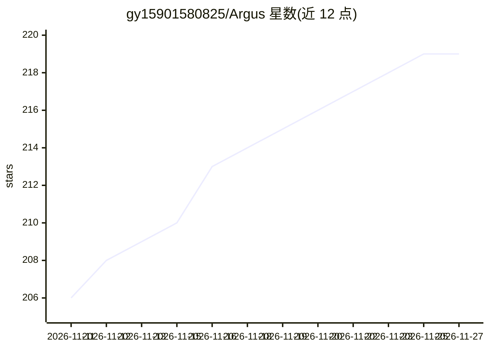

# gy15901580825/Argus

⭐ 219 · Python · Apache-2.0 · 推送 2026-11-24 · [GitHub](https://github.com/gy15901580825/Argus) · [官网](https://gy15901580825.github.io/Argus/) · 组织维护

**给 AI agent 做红队测试的 CLI：333 个探针找攻击面**

Argus 以黑盒方式对 agent 执行红队探测：通过 agent 调用的工具、读取的内容与收到的请求下发 333 个捆绑探针，覆盖 MCP 滥用、支付流程、浏览器 agent、技能扫描等场景，判定多来自测试台记录的实际行为而非模型判读。探针映射 OWASP LLM Top 10、MITRE ATLAS、NIST AI RMF 等框架，结果输出 SARIF、JUnit XML 与 HTML，可上传 GitHub Code Scanning。LLM 评委按探针评分规则运行并有成本上限；不修补目标、不保护生产环境。以 pip 包提供，Python 3.11+。

## 筛选速览

| 维度 | 判定 | 备注 |
|---|---|---|
| AI 角色 | `ai-ecosystem` | LLM/agent 周边工具 |
| 许可风险 | `permissive` | Apache-2.0 |
| 部署形态 | `self-host` | docker 或自建部署 |
| 模型依赖 | local-ok | 支持本地模型 |
| 硬件要求 | — | 无带数字的原话,不猜 |
| 安装摩擦 | `low` | 无编译、无系统依赖或容器化 |
| 成熟度 | — | 结构信号不足 |

## 能力要点

- 333 个捆绑探针，含 64 个 MCP 滥用与 27 个支付滥用探针，映射 OWASP/MITRE ATLAS/NIST AI RMF
- 无 API key 的本地 quickstart：测试内置漏洞 MCP demo agent
- argus-probe mcp-trap/scan-mcp/scan-skill 子命令测试自建 agent、MCP 服务器与 Claude Code 技能
- 16 个目标适配器与 SARIF/JUnit/HTML 报告，支持每日与单次成本上限

## 适用场景

- 给自建的 agent 跑红队探针，看哪些攻击能得手
- 在 CI 里以 JUnit/SARIF 结果做安全门禁
- 安装第三方 agent 技能前在一次性容器里扫描其行为
- 把发现按 OWASP/MITRE ATLAS 编号对接给安全团队

## 场景标签

`网络安全` `模型评测` · 领域:评测与运维

## 证据(README 行号)

> L5: **Attack your AI agent before someone else does.** Argus runs 333 red-team
> L59: wire, without source access. It picks up where unit tests and LLM evals leave
> L118:  `domain:financial-services`. The CLI has no suite option.

## 星数曲线

2026-11-11 206 → 2026-11-27 219（+13）

---
*卡片 v1 · prompt 1.4 · 生成 2026-11-25 · 置信度 mid · 依据 README sha `bc4f875da015` · [字段定义](../../DATASET.md)*
