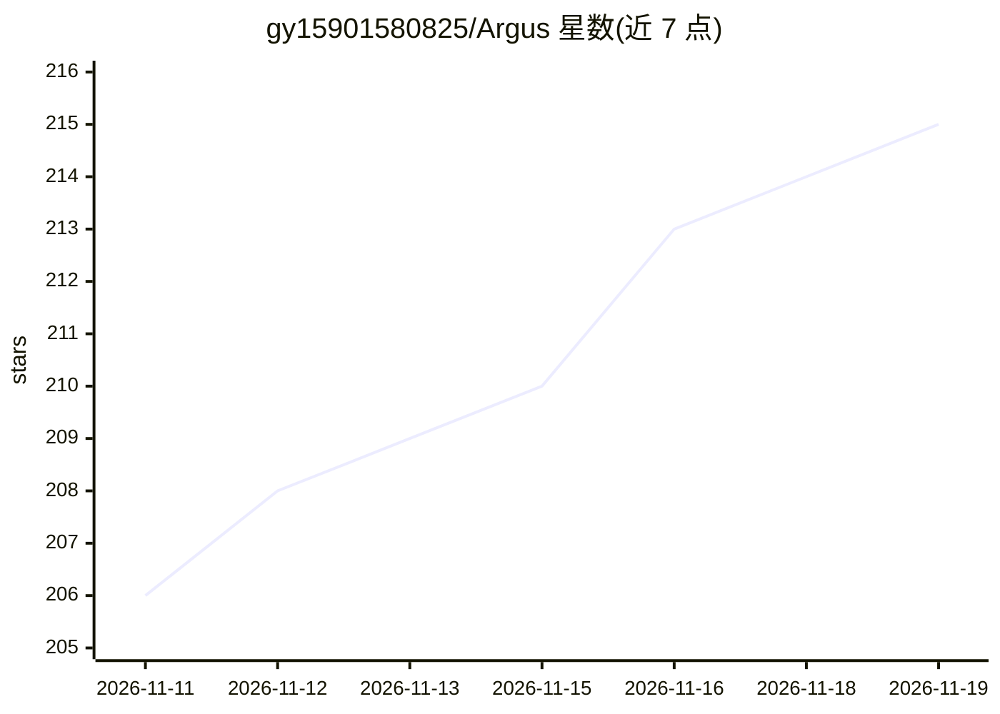

# gy15901580825/Argus

⭐ 215 · Python · Apache-2.0 · 推送 2026-11-18 · [GitHub](https://github.com/gy15901580825/Argus) · [官网](https://gy15901580825.github.io/Argus/) · 组织维护

**面向 AI agent 的红队安全测试工具：295 个攻击探针**

对 AI agent 做黑盒红队测试的 CLI 工具：内置 295 个对抗探针，覆盖 OWASP LLM Top 10、MITRE ATLAS、NIST AI RMF 等标准映射，攻击面包括恶意 MCP 服务器、支付 agent（mock x402 商家）、浏览器 agent、技能安装前的行为检查等。提供 15 种目标适配器（OpenAI 兼容、Anthropic native、gRPC、MCP、A2A 等），多数探针由确定性规则裁决，其余由 LLM judge 评估（支持多家提供商与成本上限）。结果输出 SARIF/JUnit XML/HTML，可接入 GitHub Code Scanning 与 CI。不修补目标、不做基准评测，需 Python 3.11+，Apache 2.0 许可。

## 筛选速览

| 维度 | 判定 | 备注 |
|---|---|---|
| AI 角色 | `ai-ecosystem` | LLM/agent 周边工具 |
| 许可风险 | `permissive` | Apache-2.0 |
| 部署形态 | `self-host` | docker 或自建部署 |
| 模型依赖 | local-ok | 支持本地模型 |
| 硬件要求 | — | 无带数字的原话,不猜 |
| 安装摩擦 | `low` | 无编译、无系统依赖或容器化 |
| 成熟度 | — | 结构信号不足 |

## 能力要点

- 295 个内置探针，带 OWASP LLM Top 10 / MITRE ATLAS / NIST AI RMF 标准映射
- 15 种目标适配器：openai_compat、anthropic_native、MCP、A2A、支付、浏览器等
- mcp-trap / scan-mcp / scan-skill 等专项扫描命令，多数裁决基于记录的调用而非模型判读
- SARIF 2.1.0 / JUnit XML / HTML 报告输出，SARIF 可上传 GitHub Code Scanning

## 适用场景

- 上线前对自研 agent 做红队安全测试，发现提示注入、工具滥用等漏洞
- 扫描 MCP 服务器的暴露面与工具风险
- 在 CI 中以 SARIF/JUnit 报告作为安全门禁
- 测试支付 agent 是否会被诱导重复付款或更换收款方

## 场景标签

`网络安全` · 领域:学习与行业

## 证据(README 行号)

> L27: Around those sits a library of 295 adversarial probes in all (OWASP LLM Top
> L82: - **15 target adapters**: `openai_compat`, `anthropic_native`, `custom_http`
> L57: Argus tests the agent the way an attacker would: as a black box, over the

## 星数曲线

2026-11-11 206 → 2026-11-19 215（+9）

---
*卡片 v1 · prompt 1.4 · 生成 2026-11-17 · 置信度 mid · 依据 README sha `76f649a8dcc7` · [字段定义](../../DATASET.md)*
