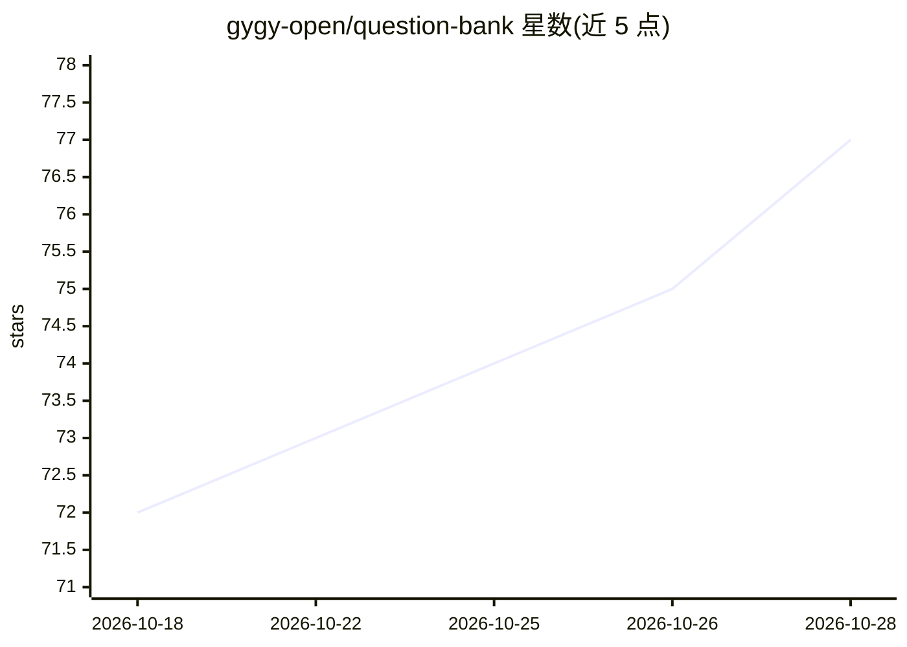

# gygy-open/question-bank

⭐ 78 · Python · AGPL-3.0 · 推送 2026-10-28 · [GitHub](https://github.com/gygy-open/question-bank) · [官网](https://gygy-open.github.io/question-bank/) · 组织维护 · 中文 README

**面向教师与教研团队的 AI 原生题库与组稿系统**

面向教师与教研团队的题库与组稿系统：AI 智能导入 Word/Markdown/图片并自动匹配知识点、生成解析，提供组稿工作台（导出 Word/LaTeX）、多学科题库管理、审核工作流（草稿→待审→发布→归档）与学科级权限。AI 部分包括多模型聊天、AI 助手改稿（预览后应用）、知识点向量化与 RAG 匹配，AI Provider/Model 可热配置。支持 Windows 桌面版（内置 SQLite，双击安装）与 Docker Compose 服务器版（MySQL + ChromaDB），采用 AGPL-3.0 协议。

## 筛选速览

| 维度 | 判定 | 备注 |
|---|---|---|
| AI 角色 | `ai-native` | 本体是模型或模型工具 |
| 许可风险 | `viral` | AGPL-3.0 |
| 部署形态 | `desktop` | 安装包/桌面程序 |
| 模型依赖 | — | README 未给出锁定关系 |
| 硬件要求 | — | 无带数字的原话,不猜 |
| 安装摩擦 | `low` | 无编译、无系统依赖或容器化 |
| 成熟度 | — | 结构信号不足 |

## 能力要点

- AI 智能导入 Word/Markdown/图片，三步流程（上传→审核→入库）
- 树形知识点向量化入库，支持 RAG 自动匹配
- AI 助手在对话中找题、建稿并预览式修改稿件
- 组稿导出 Word/LaTeX，审核工作流带完整日志

## 适用场景

- 教师个人在 Windows 桌面管理学科题库并组稿出卷
- 教研团队在局域网或服务器上协作建设共享题库
- 批量导入已有 Word/Markdown 试题并自动匹配知识点

## 场景标签

`文档解析` · 领域:知识与检索

## 证据(README 行号)

> L3: **QuestionBank** 是面向教师与教研团队的 AI 原生题库与组稿系统，覆盖 AI 智能导入、多学科题库管理、知识点匹配、审核发布与稿件编排。支持 Windows 桌面版和服务器版，既可个人使用，也可在局域网或团队环境中
> L13: |智能导入|Word / Markdown / 图片，以及带本地图片的 .zip 或整个文件夹；AI 智能抽取或标签精准解析，三步流程（上传 → 审核 → 入库）。详见 智能导入|
> L16: |知识点体系|按学科组织的树形知识点，向量化入库，支持 RAG 自动匹配|

## 星数曲线

2026-10-18 72 → 2026-10-28 77（+5）

---
*卡片 v1 · prompt 1.4 · 生成 2026-10-24 · 置信度 high · 依据 README sha `f0bf3fd4d7a9` · [字段定义](../../DATASET.md)*
