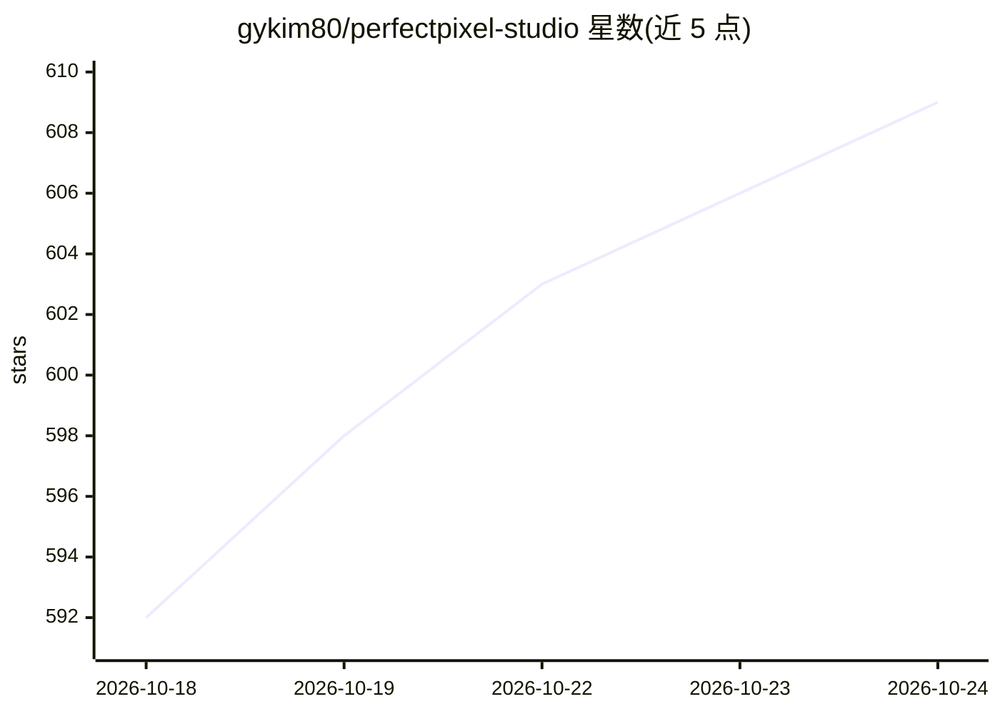

# gykim80/perfectpixel-studio

⭐ 609 · Go · MIT · 推送 2026-06-22 · [GitHub](https://github.com/gykim80/perfectpixel-studio) · 个人维护 · 中文 README

**游戏开发者的 AI 像素角色动画精灵表生成工作室**

基于 Wails + Go + React 的桌面应用：输入一行角色描述生成基础角色，再从 100+ 动作预设生成动画条与 8 方向精灵组。核心机制是让 AI 渲染、用确定性后处理保证质量——YCbCr 色度抠背景、投影轮廓+动态规划切帧、alpha 加权质心对齐、共享调色板量化像素化，配合评分驱动的不超过 3 轮自我纠错重生成。后端可选 Gemini、OpenRouter、fal.ai、BytePlus，需自带 API key。输出精灵表、Aseprite 兼容 JSON、GIF/APNG 与帧 PNG，可被 Phaser/Unity/Godot 导入。需从源码用 Wails 构建，无现成安装包。

## 筛选速览

| 维度 | 判定 | 备注 |
|---|---|---|
| AI 角色 | `ai-native` | 本体是模型或模型工具 |
| 许可风险 | `permissive` | MIT |
| 部署形态 | `library` | 以包/库形式分发 |
| 模型依赖 | locked-api |  |
| 硬件要求 | — | 无带数字的原话,不猜 |
| 安装摩擦 | `low` | 无编译、无系统依赖或容器化 |
| 成熟度 | — | 结构信号不足 |

## 能力要点

- 文本→角色→100+ 动作预设→8 方向精灵组的一站式生成
- 确定性后处理管线：YCbCr 抠像、DP 最优切帧、alpha 加权质心对齐、共享调色板像素化
- 0–100 多轴评分驱动的不超过 3 轮闭环自我纠错重生成
- 多后端支持：Gemini / OpenRouter / fal.ai / BytePlus

## 适用场景

- 为我的游戏快速产出可导入引擎的角色动画精灵表
- 从一句角色描述生成 8 方向完整动作集
- 对 AI 生成结果做逐帧审查、反馈并定向重生成

## 场景标签

`图像生成` · 领域:内容生成

## 证据(README 行号)

> L5: Turn a one-line character description into a base character, then auto-generate 100+ motion
> L51: - **Multi-provider**: choose Gemini, OpenRouter, fal.ai, or BytePlus as the backend.

## 星数曲线

2026-10-18 592 → 2026-10-24 609（+17）

---
*卡片 v1 · prompt 1.4 · 生成 2026-10-21 · 置信度 mid · 依据 README sha `c790c669044b` · [字段定义](../../DATASET.md)*
