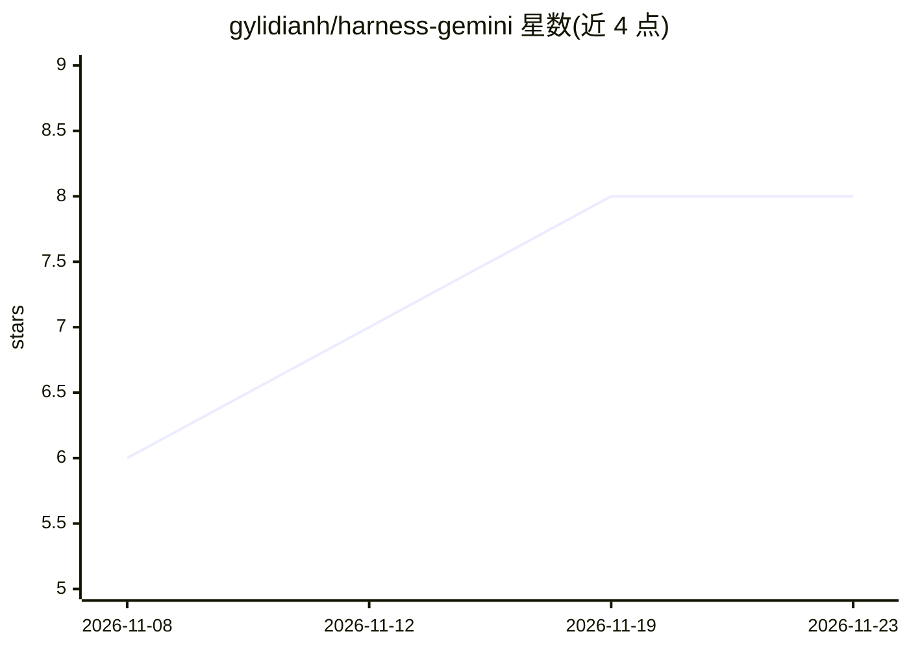

# gylidianh/harness-gemini

⭐ 8 · JavaScript · MIT · 推送 2026-11-18 · [GitHub](https://github.com/gylidianh/harness-gemini) · [官网](https://github.com/gylidianh/harness-gemini/releases/latest) · 个人维护 · 中文 README

**Windows 桌面 AI 工作台：集中聊天、编程、生图与浏览**

基于 Electron 的 Windows 桌面应用，将聊天、编程、生图、内置浏览器整合在同一窗口。关键机制：支持 OpenAI Chat Completions、Anthropic Messages、OpenAI Responses 三种协议，可保存并切换多个模型连接，为不同模式配置不同模型；内置浏览器支持多标签、网页读取与文件下载；提供技能与子代理管理、上下文压缩、权限审批模式。限制：仅提供 Windows x64 安装包，编程命令以当前 Windows 用户权限执行，会话目录不是系统沙箱，需自备可访问的模型服务与 API Key。

## 筛选速览

| 维度 | 判定 | 备注 |
|---|---|---|
| AI 角色 | `ai-native` | 本体是模型或模型工具 |
| 许可风险 | `permissive` | MIT |
| 部署形态 | `None` |  |
| 模型依赖 | — | README 未给出锁定关系 |
| 硬件要求 | — | 无带数字的原话,不猜 |
| 安装摩擦 | `low` | 无编译、无系统依赖或容器化 |
| 成熟度 | — | 结构信号不足 |

## 能力要点

- 支持 OpenAI Chat Completions、Anthropic Messages、OpenAI Responses 三种协议的多连接管理
- 聊天/编程/生图三模式可分别配置模型并在输入框切换
- 内置浏览器：多标签页、网页读取交互、文件下载
- 技能与子代理管理、任务清单与子任务进度展示

## 适用场景

- 在 Windows 本地用自配的模型服务进行日常聊天与编程
- 为聊天、编程、生图分别接入不同模型并随时切换
- 在桌面端浏览网页并下载文件，同时保持 AI 会话上下文

## 场景标签

`聊天机器人` `编码 Agent` `图像生成` · 领域:编码与开发

## 证据(README 行号)

> L3: Windows 桌面 AI 工作台，在一个窗口中聊天、编程、生图和浏览网页。
> L22: |模型连接|支持 OpenAI Chat Completions、Anthropic Messages、OpenAI Responses 协议；可保存和切换多个连接|

## 星数曲线

2026-11-08 6 → 2026-11-23 8（+2）

---
*卡片 v1 · prompt 1.4 · 生成 2026-11-20 · 置信度 high · 依据 README sha `ea0134749e53` · [字段定义](../../DATASET.md)*
