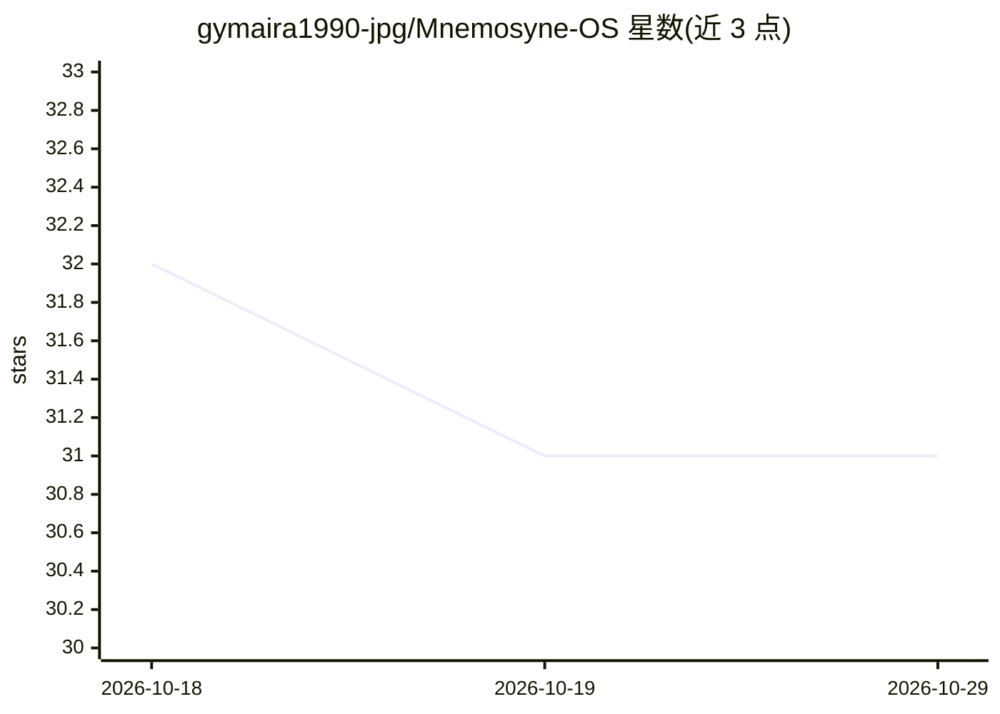

# gymaira1990-jpg/Mnemosyne-OS

⭐ 31 · Python · MIT · 推送 2026-10-25 · [GitHub](https://github.com/gymaira1990-jpg/Mnemosyne-OS) · [官网](https://g-cat.cn) · 个人维护 · 中文 README

**面向 AI agent 的自托管长期记忆系统（认知记忆 OS）**

为 AI agent 提供长期记忆管理的自托管服务：对话结束后触发蒸馏流水线（事实抽取→分类归档→生成档案号与卡片），按 7 翼×20 室的分类体系组织记忆宫殿，支持 3 通道召唤检索（名称/引导/共鸣）、WIKI 知识库（向量+BM25+RRR 融合）、程序性技能记忆与上下文注入调度。技术栈为 FastAPI + PostgreSQL 16 + pgvector，事实抽取使用 DeepSeek/豆包双 LLM 后端，提供 Hermes 集成（14 个工具）与 Python SDK，支持边缘-云端同步。需自行部署 PostgreSQL 并配置 LLM API key。

## 筛选速览

| 维度 | 判定 | 备注 |
|---|---|---|
| AI 角色 | `ai-ecosystem` | LLM/agent 周边工具 |
| 许可风险 | `permissive` | MIT |
| 部署形态 | `library` | 以包/库形式分发 |
| 模型依赖 | — | README 未给出锁定关系 |
| 硬件要求 | — | 无带数字的原话,不猜 |
| 安装摩擦 | `low` | 无编译、无系统依赖或容器化 |
| 成熟度 | — | 结构信号不足 |

## 能力要点

- 记忆生命周期：capture → distill → age → forget → resurface，档案号定位（如 K·NET·PROXY·2026-0007）
- 3 通道召唤检索（name/guide/resonate），WIKI 语义检索（HNSW+BM25+RRF 融合）
- Hermes Memory Provider 提供 14 个工具，含注入调度器（v7.7.0）
- 边缘-云端同步（SQLite ↔ PostgreSQL），FastAPI 50+ 端点

## 适用场景

- 让跨周运行的 agent 保留并调取长期记忆
- 为 Hermes agent 配置外部记忆提供方
- 以知识库形式归档论文/计划全文并语义检索

## 场景标签

`Agent 记忆` `知识图谱` · 领域:Agent 开发

## 证据(README 行号)

> L10:  A Cognitive Memory Operating System for AI Agents
> L33: |**Agent**|Hermes Memory Provider (14 tools incl. palace_summon) · auto-extract|
> L167: hermes config set memory.provider mnemosyne

## 星数曲线

2026-10-18 32 → 2026-10-29 31（-1）

---
*卡片 v1 · prompt 1.4 · 生成 2026-10-26 · 置信度 mid · 依据 README sha `1d763559a52b` · [字段定义](../../DATASET.md)*
