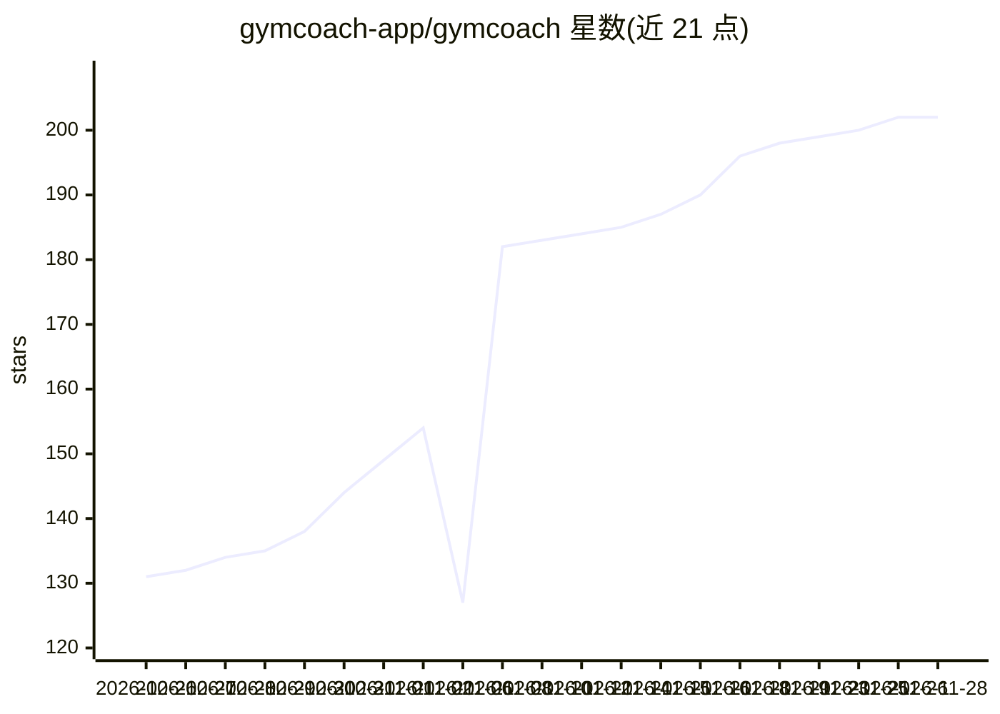

# gymcoach-app/gymcoach

⭐ 202 · TypeScript · MIT · 推送 2026-11-27 · [GitHub](https://github.com/gymcoach-app/gymcoach) · [官网](https://demo-gymcoach.mesureprivee.com) · 个人维护

**自托管健身训练追踪器，可选接入自选 LLM 的 AI 教练**

可自托管的力量与有氧训练追踪应用：组数/次数/RIR 快速记录、e1RM 与容量分析、肌肉热图、手表 FIT/TCX/GPX 有氧导入、多用户数据隔离与离线 PWA。不配置 LLM key 时作为纯追踪器运行；配置 Anthropic、OpenRouter 或本地模型 key 后启用 AI 教练、对话与训练计划生成，并支持 ChatGPT/MCP 连接器。通过 Docker 一键部署，数据存于自有数据库。

## 筛选速览

| 维度 | 判定 | 备注 |
|---|---|---|
| AI 角色 | `ai-enhanced` | 去掉 AI 部分产品仍成立 |
| 许可风险 | `permissive` | MIT |
| 部署形态 | `self-host` | docker 或自建部署 |
| 模型依赖 | local-ok | 支持本地模型 |
| 硬件要求 | — | 无带数字的原话,不猜 |
| 安装摩擦 | `low` | 无编译、无系统依赖或容器化 |
| 成熟度 | — | 结构信号不足 |

## 能力要点

- 无 AI key 时仍可作为完整追踪器使用，配置 key 后启用教练、聊天与计划生成
- 支持 Anthropic API、OpenRouter 模型或本地模型，使用用户自己的 key
- 自然语言训练记录解析与一句话生成训练计划
- 自带自主开发实验机制：Claude Code agents 按 CI 门控流程维护代码

## 适用场景

- 在家庭服务器上自托管训练日志，数据不出本机
- 让 AI 教练基于自己的历史训练数据给周度指导
- 从手表文件导入有氧记录并集中管理力量与心肺训练

## 场景标签

 · 领域:健身/健康工具

## 证据(README 行号)

> L34: Looking for a self-hosted alternative to Strong, Hevy or Fitbod? GymCoach is a
> L49: With no AI key set, GymCoach is still a clean, fast tracker. Add a key later to
> L67: Open <http://localhost:3000> and create your account. To turn the coach on, add

## 星数曲线

2026-10-26 131 → 2026-11-28 202（+71）

---
*卡片 v1 · prompt 1.4 · 生成 2026-11-28 · 置信度 high · 依据 README sha `26ebbf44cb05` · [字段定义](../../DATASET.md)*
