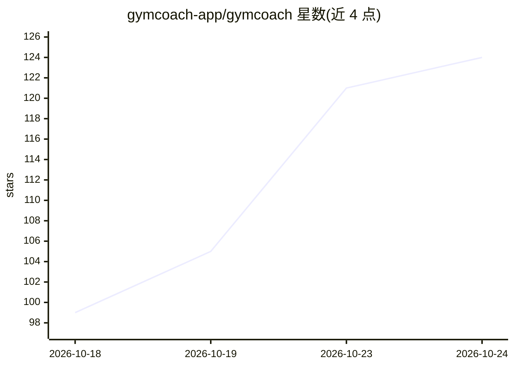

# gymcoach-app/gymcoach

⭐ 127 · TypeScript · MIT · 推送 2026-10-23 · [GitHub](https://github.com/gymcoach-app/gymcoach) · [官网](https://demo-gymcoach.mesureprivee.com) · 组织维护

**自托管健身记录器，带基于自有训练数据的 AI 教练**

基于 Next.js 的自托管力量与有氧训练追踪应用：快速记录组数/次数/RIR、进阶图表（e1RM、容量、肌肉热图）、手表文件导入（FIT/TCX/GPX，无云账号）、离线 PWA。AI 教练读取用户训练数据，提供每周总结、流式对话、一句话生成训练计划，模型由用户自带（Anthropic SDK 或任意 OpenRouter 模型）；未设置 key 时仍是完整可用的记录器。一条 Docker compose 命令完成自托管。仓库同时由 Claude Code agent 流水线维护（与应用内教练相互独立）。

## 筛选速览

| 维度 | 判定 | 备注 |
|---|---|---|
| AI 角色 | `ai-enhanced` | 去掉 AI 部分产品仍成立 |
| 许可风险 | `permissive` | MIT |
| 部署形态 | `self-host` | docker 或自建部署 |
| 模型依赖 | locked-api |  |
| 硬件要求 | — | 无带数字的原话,不猜 |
| 安装摩擦 | `low` | 无编译、无系统依赖或容器化 |
| 成熟度 | — | 结构信号不足 |

## 能力要点

- AI 教练基于用户自身训练数据，展示给模型的结构化上下文可查看
- 自带模型：Anthropic SDK 或任意 OpenRouter 模型，无 key 时应用仍完整可用
- 手表文件导入（Garmin FIT/TCX/GPX），无 OAuth 无云账号，含心率曲线与有氧脱耦
- 内置 11 套训练模板（5/3/1 BBB、GZCLP、nSuns 等），可按原文执行并编辑

## 适用场景

- 在自己的服务器上记录力量与有氧训练，数据留在本地数据库
- 让 AI 教练基于我的训练历史给出每周总结、对话指导与计划生成
- 从运动手表离线导入跑步骑行数据并查看心率分析

## 场景标签

 · 领域:健身/健康应用

## 证据(README 行号)

> L49: With no AI key set, GymCoach is still a clean, fast tracker. Add a key later to
> L224: - **Your provider** - Anthropic SDK or any OpenRouter model. With no key set,

## 星数曲线

2026-10-18 99 → 2026-10-24 124（+25）

---
*卡片 v1 · prompt 1.4 · 生成 2026-10-23 · 置信度 mid · 依据 README sha `20e543c58c77` · [字段定义](../../DATASET.md)*
