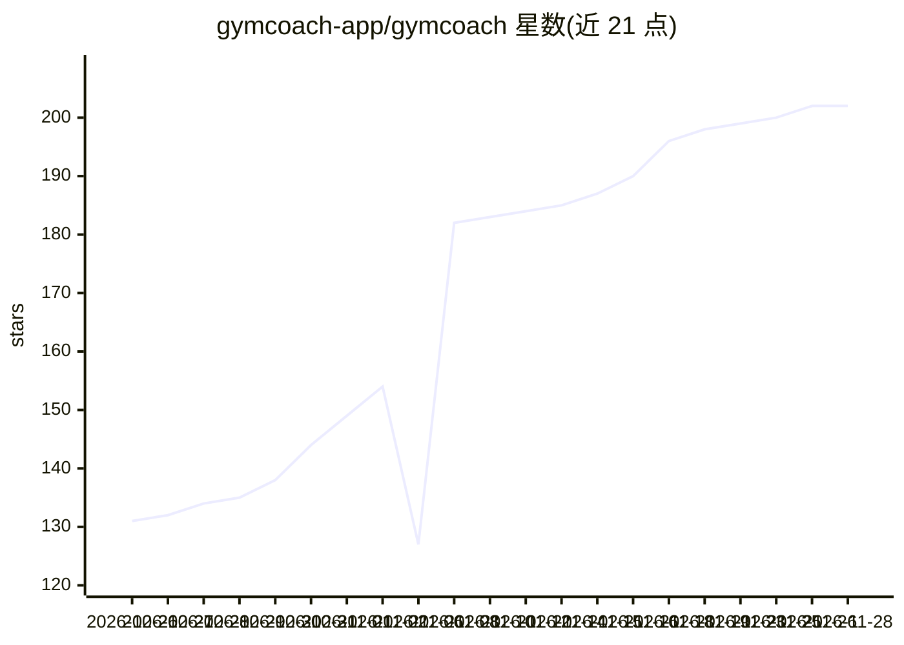

# gymcoach-app/gymcoach

⭐ 202 · TypeScript · MIT · 推送 2026-11-27 · [GitHub](https://github.com/gymcoach-app/gymcoach) · [官网](https://demo-gymcoach.mesureprivee.com) · 个人维护

**自托管健身追踪器，AI 教练基于你的训练数据提供周指导**

自托管的健身训练追踪器，覆盖力量与有氧：快速组数记录、e1RM/容量/肌肉热力图等进度分析、5/3/1 等经典课程表、FIT/TCX/GPX 手表文件导入、离线可安装 PWA、多用户与简体中文等 11 种界面语言。AI 部分包括：读取训练数据的周教练、自然语言记录解析、一句话生成训练计划；通过 ANTHROPIC_API_KEY、OpenRouter 或本地模型启用，未配置 key 时仍是完整追踪器。以 Docker 一键部署，MIT 许可，README 还说明仓库由 Claude Code 代理自主开发维护。

## 筛选速览

| 维度 | 判定 | 备注 |
|---|---|---|
| AI 角色 | `ai-enhanced` | 去掉 AI 部分产品仍成立 |
| 许可风险 | `permissive` | MIT |
| 部署形态 | `self-host` | docker 或自建部署 |
| 模型依赖 | local-ok | 支持本地模型 |
| 硬件要求 | — | 无带数字的原话,不猜 |
| 安装摩擦 | `low` | 无编译、无系统依赖或容器化 |
| 成熟度 | — | 结构信号不足 |

## 能力要点

- AI 教练读取用户自身训练数据，支持 Anthropic/OpenRouter/本地模型自带 key
- 自然语言记录解析与一句话生成训练计划
- 力量+有氧全功能追踪：e1RM、MEV/MRV 容量带、肌肉热力图、停滞检测与减载建议
- FIT/TCX/GPX 手表文件导入，无需云端账号

## 适用场景

- 在家自建服务器管理自己的力量与有氧训练记录
- 让 AI 教练根据历史数据生成并解释训练计划
- 无云端依赖地导入 Garmin 等手表的有氧数据

## 场景标签

 · 领域:健康/健身工具

## 证据(README 行号)

> L34: Looking for a self-hosted alternative to Strong, Hevy or Fitbod? GymCoach is a
> L49: With no AI key set, GymCoach is still a clean, fast tracker. Add a key later to

## 星数曲线

2026-10-26 131 → 2026-11-28 202（+71）

---
*卡片 v1 · prompt 1.4 · 生成 2026-11-26 · 置信度 high · 依据 README sha `e203831b1afb` · [字段定义](../../DATASET.md)*
