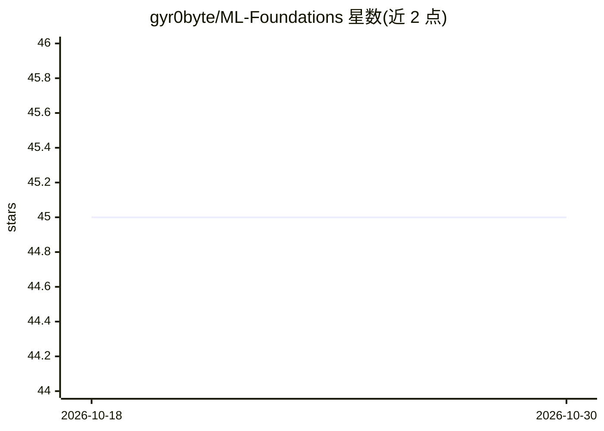

# gyr0byte/ML-Foundations

⭐ 45 · Jupyter Notebook · MIT · 推送 2026-10-12 · [GitHub](https://github.com/gyr0byte/ML-Foundations) · 个人维护

**从 NumPy 到深度学习的 ML 学习笔记本系列（65 本）**

以 Jupyter 笔记本为主的手把手机器学习学习仓库，共 65 本笔记本，覆盖 Python/NumPy、Pandas、数据可视化（Matplotlib/Plotly）、统计检验（Z/T/卡方/ANOVA）、集成学习、模型调优、监督与无监督学习、PCA、NLP，以及 ANN/CNN/RNN 深度学习和 4 本 Hugging Face Transformers 笔记本；另含 Streamlit 心脏病预测演示应用。安装方式为 git clone 后 pip install requirements.txt，Transformers 章节推荐在 Google Colab GPU 运行时执行；部分大数据集与模型工件被 .gitignore 排除，需重新运行生成。

## 筛选速览

| 维度 | 判定 | 备注 |
|---|---|---|
| AI 角色 | `ai-knowledge` | 知识聚合/清单类 |
| 许可风险 | `permissive` | MIT |
| 部署形态 | `library` | 以包/库形式分发 |
| 模型依赖 | — | README 未给出锁定关系 |
| 硬件要求 | — | 无带数字的原话,不猜 |
| 安装摩擦 | `low` | 无编译、无系统依赖或容器化 |
| 成熟度 | — | 结构信号不足 |

## 能力要点

- 65 本笔记本，按难度递进组织学习路径
- 覆盖 NumPy→Pandas→可视化→统计→ML→DL→Transformers 完整路线
- 含 Streamlit 心脏病预测交互演示（保存的 SVM 模型）
- 4 本 Hugging Face Transformers 笔记本并附 Colab GPU 指引

## 适用场景

- 系统自学机器学习与深度学习基础
- 在 Colab 上动手练习 Hugging Face Transformers 流水线
- 通过心脏病预测 Streamlit 应用了解模型部署演示

## 场景标签

`教程课程` · 领域:学习与行业

## 证据(README 行号)

> L3: > A completed, hands-on learning series covering Python, NumPy, machine learning, and deep learning through practica
> L20: Notebook-first workspace for building strong ML foundations with short, focused lessons and runnable examples.
> L28: - ✅ **65 notebooks** — 13 NumPy, 3 NumPy exercises, 10 Pandas, 2 Pandas exercises, 7 Data Viz, 6 Statistics, 3 Foun

## 星数曲线

2026-10-18 45 → 2026-10-30 45（+0）

---
*卡片 v1 · prompt 1.4 · 生成 2026-10-25 · 置信度 high · 依据 README sha `2cc7d2edc5ac` · [字段定义](../../DATASET.md)*
