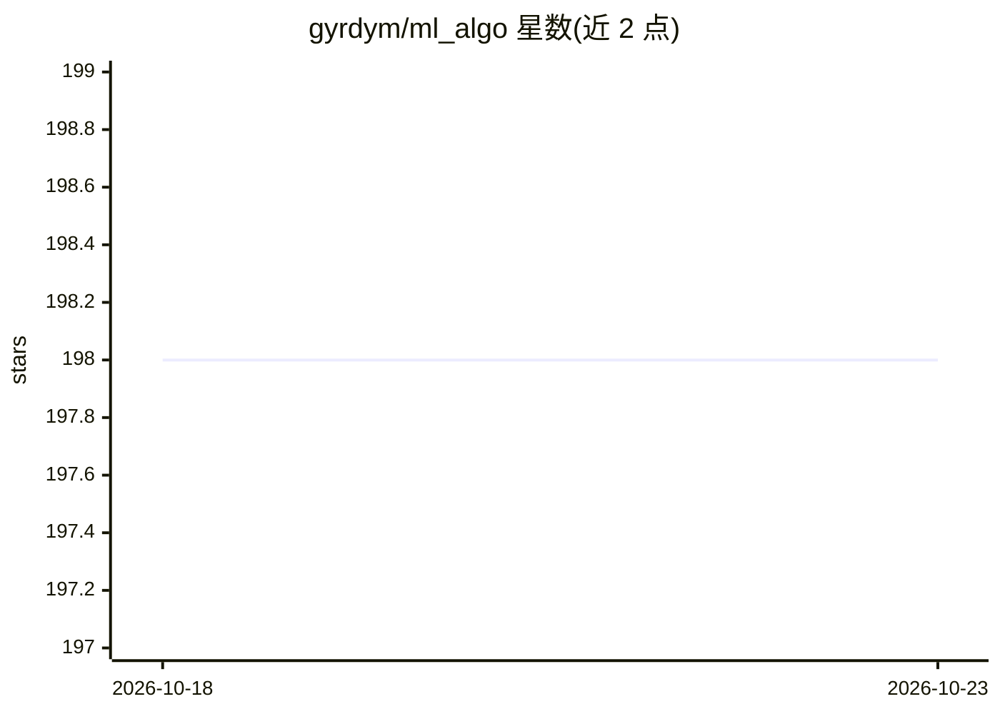

# gyrdym/ml_algo

⭐ 198 · Dart · BSD-2-Clause · 推送 2026-07-26 · [GitHub](https://github.com/gyrdym/ml_algo) · [官网](https://gyrdym.github.io/ml_algo/) · 个人维护

**Dart 原生机器学习算法库，供 Dart/Flutter 开发者做分类回归**

面向 Dart 语言与数据科学交叉开发者的机器学习库，提供逻辑回归（SGD/BGD/Newton）、Softmax 回归、决策树、KNN、线性回归（lasso/SGD/BGD/Newton）、KDTree 与局部敏感哈希等算法，以及 k 折交叉验证的模型选择工具。面向 Dart VM 与 Flutter，核心功能可通过 WebAssembly 用于 Web 应用。限制：分类回归器只处理数值数据，不处理字符串、布尔与空值，需配合 ml_preprocessing 预处理；线性分类器要求数据线性可分。模型可保存为 JSON 并重新读取。

## 筛选速览

| 维度 | 判定 | 备注 |
|---|---|---|
| AI 角色 | `ai-native` | 本体是模型或模型工具 |
| 许可风险 | `permissive` | BSD-2-Clause |
| 部署形态 | `None` |  |
| 模型依赖 | — | README 未给出锁定关系 |
| 硬件要求 | — | 无带数字的原话,不猜 |
| 安装摩擦 | `low` | 无编译、无系统依赖或容器化 |
| 成熟度 | — | 结构信号不足 |

## 能力要点

- 多种求解器的逻辑回归与线性回归实现（SGD/BGD/Newton/lasso）
- 决策树、KNN、KDTree、局部敏感哈希（随机二进制投影）等算法
- CrossValidator 支持 k 折交叉验证与超参数调优
- 模型可保存为 JSON 文件并读取复用

## 适用场景

- 在 Flutter 应用内训练并运行分类/回归模型
- 在 Dart 桌面应用中做数据科学建模
- 通过交叉验证评估超参数与模型泛化误差

## 场景标签

 · 领域:机器学习/软件开发

## 证据(README 行号)

> L8: - ml_algo library - implementation of popular machine learning algorithms
> L19: The main purpose of the library is to give native Dart implementation of machine learning algorithms to those who a
> L20: interested both in Dart language and data science. This library aims at Dart VM and Flutter. It is also possible to

## 星数曲线

2026-10-18 198 → 2026-10-23 198（+0）

---
*卡片 v1 · prompt 1.4 · 生成 2026-10-22 · 置信度 high · 依据 README sha `29023c8ebccf` · [字段定义](../../DATASET.md)*
