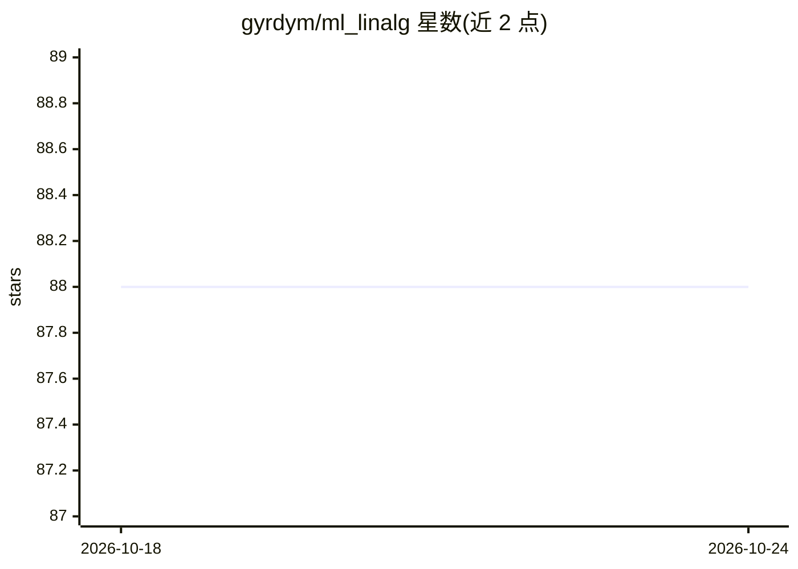

# gyrdym/ml_linalg

⭐ 88 · Dart · BSD-2-Clause · 推送 2026-10-04 · [GitHub](https://github.com/gyrdym/ml_linalg) · 个人维护

**Dart 语言的 SIMD 向量/矩阵线性代数与统计运算库**

基于 Dart SIMD 数据类型（Float32x4/Float64x2）实现的数值计算库，提供不可变 Vector 类及向量运算：加减乘除、点积、欧氏/曼哈顿/余弦距离、范数、均值/中位数/求和/连乘、幂/指数、归一化与 min-max 缩放等。默认使用 float32 表示，float64 更精确但性能较低；部分操作（与 List 混合或跨 dtype 运算）不受益于 SIMD。面向在 Dart 中进行数据科学与机器学习算法计算的开发者，以 pub 包形式分发，README 附带基准测试目录说明。

## 筛选速览

| 维度 | 判定 | 备注 |
|---|---|---|
| AI 角色 | `ai-ecosystem` | LLM/agent 周边工具 |
| 许可风险 | `permissive` | BSD-2-Clause |
| 部署形态 | `None` |  |
| 模型依赖 | — | README 未给出锁定关系 |
| 硬件要求 | — | 无带数字的原话,不猜 |
| 安装摩擦 | `low` | 无编译、无系统依赖或容器化 |
| 成熟度 | — | 结构信号不足 |

## 能力要点

- 基于 Float32x4/Float64x2 的 SIMD 向量实现
- 向量不可变，运算返回新实例，实现 Iterable<double> 接口
- 支持范数、距离度量、均值/中位数、归一化等统计运算
- 提供基准测试对比（List 求和 15 秒 vs 向量 0.7 秒）

## 适用场景

- 在 Dart 项目中做机器学习算法的向量化计算
- 对数据做归一化、距离度量与统计汇总
- 需要高精度或高性能数值计算时在 float32/float64 间选择

## 场景标签

 · 领域:数学/数值计算库

## 证据(README 行号)

> L4: **SIMD-based linear algebra and statistics for data science with Dart**
> L51: &nbsp;&nbsp;&nbsp;&nbsp;The library contains two high performant vector classes based on Float32x4
> L13: Vectors and matrices are practical tools in real-life applications, such as machine learning algorithms. These sign

## 星数曲线

2026-10-18 88 → 2026-10-24 88（+0）

---
*卡片 v1 · prompt 1.4 · 生成 2026-10-23 · 置信度 mid · 依据 README sha `45f701a9e3e7` · [字段定义](../../DATASET.md)*
