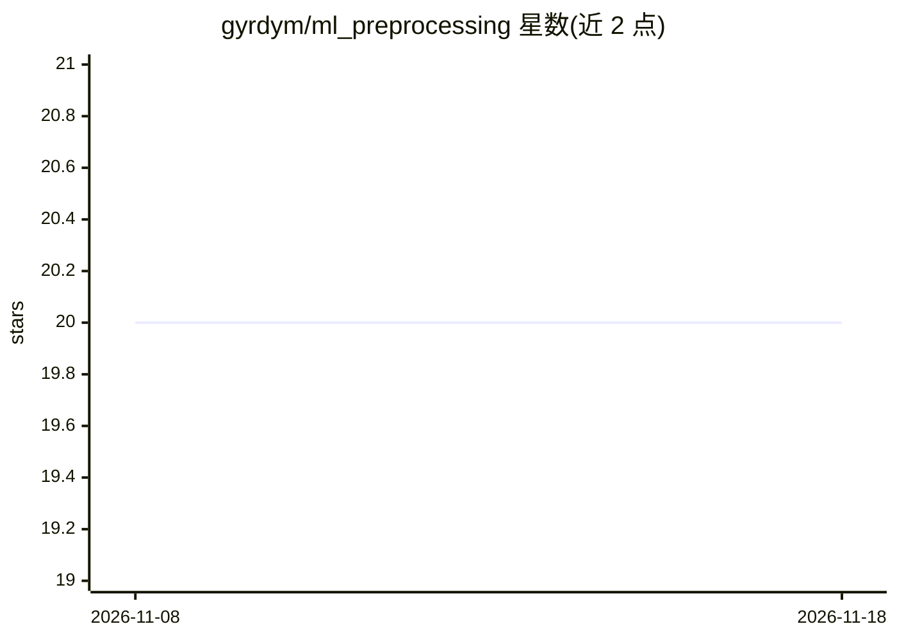

# gyrdym/ml_preprocessing

⭐ 20 · Dart · BSD-2-Clause · 推送 2026-11-07 · [GitHub](https://github.com/gyrdym/ml_preprocessing) · 个人维护

**面向 Dart 的机器学习数据预处理算法库**

Dart 语言实现的 ML 数据预处理库，为使用 Dart 的数据科学家提供常见预处理技术：类别数据的 one-hot 编码与标签编码、数值数据归一化（欧氏/曼哈顿范数）、标准化，以及将多个操作串联的 Pipeline。使用前需依赖 ml_dataframe 将数据打包为 DataFrame，编码器需先 fit 再 process；归一化要求输入已编码为数值。以 pub 包形式分发。

## 筛选速览

| 维度 | 判定 | 备注 |
|---|---|---|
| AI 角色 | `ai-native` | 本体是模型或模型工具 |
| 许可风险 | `permissive` | BSD-2-Clause |
| 部署形态 | `None` |  |
| 模型依赖 | — | README 未给出锁定关系 |
| 硬件要求 | — | 无带数字的原话,不猜 |
| 安装摩擦 | `low` | 无编译、无系统依赖或容器化 |
| 成熟度 | — | 结构信号不足 |

## 能力要点

- one-hot / label 类别编码，支持先拟合后应用
- Normalizer 向量归一化与 Standardizer 标准化
- Pipeline 串联预处理操作，提供 pipeable 算子函数

## 适用场景

- 将含字符串类别列的数据集转为数值表示以训练分类器
- 对特征做归一化/标准化以满足算法输入要求
- 在 Dart 项目中组装可复用的预处理流水线

## 场景标签

 · 领域:机器学习/数据科学工具

## 证据(README 行号)

> L30: The aim of the library is to give data scientists, who are interested in Dart programming language, these preproces
> L31: techniques.

## 星数曲线

2026-11-08 20 → 2026-11-18 20（+0）

---
*卡片 v1 · prompt 1.4 · 生成 2026-11-18 · 置信度 high · 依据 README sha `f35796e1d9f3` · [字段定义](../../DATASET.md)*
