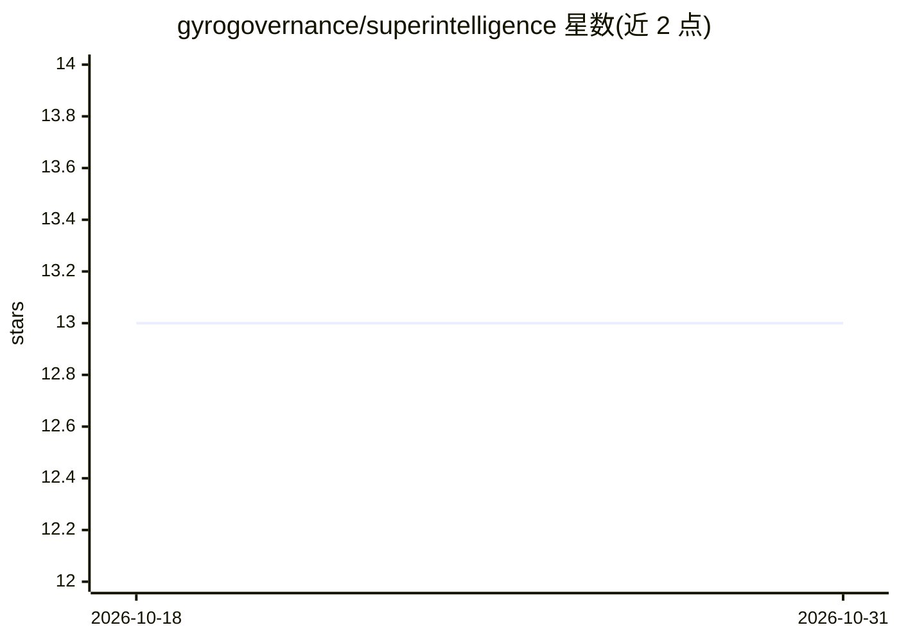

# gyrogovernance/superintelligence

⭐ 13 · Python · MIT · 推送 2026-10-05 · [GitHub](https://github.com/gyrogovernance/superintelligence) · [官网](https://gyrogovernance.com/) · 个人维护

**面向 AGI/ASI 治理的 hQVM 内核与配套运行时/研究套件**

以 MIT 许可发布的 Python 仓库，核心是 hQVM（全息量子虚拟机）：一个有限状态内核，将 append-only 字节日志转为可复现状态，使用精确整数运算，可在普通硬件运行，状态空间固定为 4,096 个可达状态，不含学习模型。围绕内核提供：Gyroscopic 运行时（共振定义的细胞池、实时管理 LLM 资源分配）、群等变自编码器套件 hQVM AE（含基因组学应用，宣称在 E. coli/酵母等数据上有实验结果）、AIR 对齐治理框架与 Moments Economy 经济框架。声明本身不是自主 agent，不解释内容或制定政策，权威与责任保留在人类。README 未给出安装运行命令。

## 筛选速览

| 维度 | 判定 | 备注 |
|---|---|---|
| AI 角色 | `ai-ecosystem` | LLM/agent 周边工具 |
| 许可风险 | `permissive` | MIT |
| 部署形态 | `None` |  |
| 模型依赖 | — | README 未给出锁定关系 |
| 硬件要求 | — | 无带数字的原话,不猜 |
| 安装摩擦 | `low` | 无编译、无系统依赖或容器化 |
| 成熟度 | — | 结构信号不足 |

## 能力要点

- hQVM 内核：字节日志→可复现状态，精确整数运算，无学习模型
- hQVM AE 群等变自编码器套件，应用覆盖机制可解释性与基因组学
- Gyroscopic 运行时按结构状态动态管理 LLM 资源分配
- AIR 框架将安全工作转化为可回放验证的付费贡献

## 适用场景

- 研究可复现的事件溯源与防篡改审计日志内核
- 在已知代数系统上做机制可解释性对照实验
- 按可回放凭证协调 AI 安全工作与经费治理

## 场景标签

`科研工具` · 领域:学习与行业

## 证据(README 行号)

> L66: The **hQVM** (Holonomic Quantum Virtual Machine) is a compact, finite-state kernel that turns an append-only byte l
> L101: - **Real-time AI control:** structural state dynamically manages LLM resource allocation (e.g., adjusting context 

## 星数曲线

2026-10-18 13 → 2026-10-31 13（+0）

---
*卡片 v1 · prompt 1.4 · 生成 2026-10-31 · 置信度 mid · 依据 README sha `cf2911777f1c` · [字段定义](../../DATASET.md)*
